# B5-2 - 파일이 언제 어떻게 바뀌었는지 기록하는 작은 프로그램 만들기

## 과제 개요
Git이 커밋을 저장하고 찾는 방식을 직접 구현한 CLI 프로그램
- 하지 않는 것
  - 실제 파일 내용은 추적하지 않음 (파일 저장, 원격 저장소 푸시 없음)
- 하는 것
  - 커밋의 메타 데이터(작성자, 시각, 메시지, 부모 커밋)만 기록
- 데이터는 **실행 중인 파이썬 프로그램의 RAM(메인 메모리)** 에만 저장
  - 커밋·브랜치는 파이썬 객체(`dict`, `list`)로만 존재함 (파일이나 DB에는 저장하지 않음)
  - 그래서 `exit`으로 프로그램(파이썬 프로세스)이 종료되면 모두 사라짐
  - 과제 제약: "데이터 영속성(파일 저장)은 구현하지 않아도 된다(메모리 상 동작으로 충분)"

<br>
 
## 목차

1. [과제 소개](#1-과제-소개)
    - [1-1. 기능](#1-1-기능)
    - [1-2. 실행 방법](#1-2-실행-방법)
    - [1-3. 사용한 자료구조](#1-3-사용한-자료구조)
    - [1-4. 사용한 알고리즘](#1-4-사용한-알고리즘)
2. [배경 지식](#2-배경-지식)
3. [사용한 자료구조](#3-사용한-자료구조)
4. [사용한 알고리즘](#4-사용한-알고리즘)
5. [설계](#5-설계)
6. [예외 처리](#6-예외-처리)
7. [조건 변경 실험](#7-조건-변경-실험) → 상세 : [docs/condition-change.md](docs/condition-change.md)
8. [테스트](#8-테스트)

<br>

## 요구사항 체크리스트

### 최종 결과물

| 요구사항 | 확인 | README 위치 |
|---|---|---|
| `INIT`, `BRANCH`, `SWITCH`, `COMMIT` 결과 출력 (커밋은 hash 포함) | ✅ | [1-1. 기능](#1-1-기능), [시연 1](#시연-1-브랜치를-나눠서-커밋) |
| `LOG`, `PATH`, `ANCESTORS` (경로가 없으면 `No path`) | ✅ | [4-1](#4-1-위상-정렬--log) ~ [4-3](#4-3-bfs-조상-탐색--ancestors), [시연 2](#시연-2-경로-조상-검색) |
| `SEARCH <keyword>`, `SEARCH --author=<name>`, `LOG --sort-by=date\|author` | ✅ | [3-5](#3-5-역색인), [4-4](#4-4-정렬--log---sort-by), [시연 3](#시연-3-작성자-변경-작성자-검색-정렬) |
| `mini-git>` 프롬프트 반복 입력, `exit` / `quit`으로 종료 | ✅ | [1-2. 실행 방법](#1-2-실행-방법), [2. 처리 흐름](#commit의-처리-흐름) |
| `main.py` + `README.md`, `python main.py`로 실행 | ✅ | [1-2. 실행 방법](#1-2-실행-방법), [5-1. 구조](#5-1-프로젝트-구조) |

### 제약 사항

| 요구사항 | 확인 | README 위치 |
|---|---|---|
| Python 3.10 이상 | ✅ | [1-2. 실행 방법](#1-2-실행-방법) |
| 그래프 전용 라이브러리 미사용 (큐로 표준 `collections.deque`만 사용) | ✅ | [3-3](#3-3-큐-queue--덱-deque) |
| 정렬 표준 API 미사용 (테스트로 소스 자동 검사) | ✅ | [4-4](#4-4-정렬--log---sort-by), [8. 테스트](#8-테스트) |
| 탐색 / 정렬 / 인덱싱을 독립 파일로 분리 | ✅ | [5-1. 계층 구조](#계층-구조), [5-3. 그래프 탐색 재사용](#5-3-그래프-탐색은-어떻게-재사용하나) |
| 주요 함수·클래스에 docstring | ✅ | [5-4. 주석 작성 기준](#5-4-주석-작성-기준), 각 소스 파일 |
| 파일 내용 추적, 네트워크, 파일 저장 없음 | ✅ | [과제 개요](#과제-개요) |

### 보너스

| 요구사항 | 확인 | README 위치 |
|---|---|---|
| `DIFF` 줄 단위 비교 (추가 / 삭제 / 공통) | ✅ | [4-5](#4-5-보너스-lcs--diff), [시연 5](#시연-5-보너스-diff-bench) |
| `MERGE` 부모 2개 merge 커밋 | ✅ | [4-6](#4-6-보너스-병합-커밋--merge), [시연 4](#시연-4-보너스-merge) |
| 정렬 알고리즘 2개 이상 구현 + 실행 시간 비교 (`BENCH`) | ✅ | [4-4](#4-4-정렬--log---sort-by), [시연 5](#시연-5-보너스-diff-bench) |

<br>

## 기능 시연 자동화 (`demo.py`)

  ```bash
  python3 demo.py          # 모든 장면을 한 번에 출력
  python3 demo.py --step   # 장면마다 Enter를 눌러 넘기기
  ```
 
  <details>
  <summary><b>시연 결과</b></summary>

  hash는 실행할 때마다 새로 만들어진다. (직접 실행하면 값이 다름)

  - 아래는 `python3 main.py`에 직접 입력한 예시 (`demo.py`는 같은 내용을 아래 시연 구성 표의 10장면으로 나눠 실행)

  #### 시연 1. 브랜치를 나눠서 커밋

  ```text
  mini-git> init "Alice"
  Initialized repository.
  Current branch: main
  Current user: Alice

  mini-git> commit "Initial commit"
  [main 505181a] Initial commit

  mini-git> branch feature
  Created branch: feature

  mini-git> switch feature
  Switched to branch: feature

  mini-git> commit "Add login feature"
  [feature 15809e9] Add login feature

  mini-git> switch main
  Switched to branch: main

  mini-git> commit "Add payment feature"
  [main 78ca51e] Add payment feature

  mini-git> log
  commit 505181a (Alice, 2026-10-11 03:56:11) [main]
  Initial commit
  commit 15809e9 (Alice, 2026-10-11 03:56:11) [feature]
  Add login feature
  commit 78ca51e (Alice, 2026-10-11 03:56:11) [main]
  Add payment feature
  ```

  ```mermaid
  flowchart RL
      P["78ca51e<br/>Add payment feature<br/>(main)"] --> I["505181a<br/>Initial commit"]
      L["15809e9<br/>Add login feature<br/>(feature)"] --> I
  ```

  - 확인 포인트: 부모 `505181a`가 LOG에서 가장 먼저 출력

  #### 시연 2. 경로, 조상, 검색

  ```text
  mini-git> path 15809e9 78ca51e
  Path: 15809e9 -> 505181a -> 78ca51e

  mini-git> ancestors 78ca51e
  Ancestors of 78ca51e (1):
  - 505181a: Initial commit

  mini-git> search "login"
  Found 1 commit:
  - 15809e9: Add login feature
  ```

  - 확인 포인트: 형제 커밋끼리는 공통 부모 `505181a`를 거쳐 연결

  #### 시연 3. 작성자 변경, 작성자 검색, 정렬

  ```text
  mini-git> init "Bob"
  Reinitialized repository (history kept).
  Current branch: main
  Current user: Bob

  mini-git> commit "Fix login bug"
  [main 043dbc1] Fix login bug

  mini-git> search --author=bob
  Found 1 commit:
  - 043dbc1: Fix login bug

  mini-git> search "LOGIN"
  Found 2 commits:
  - 15809e9: Add login feature
  - 043dbc1: Fix login bug

  mini-git> log --sort-by=author
  commit 505181a (Alice, 2026-10-11 03:56:11)
  Initial commit
  commit 15809e9 (Alice, 2026-10-11 03:56:11)
  Add login feature
  commit 78ca51e (Alice, 2026-10-11 03:56:11)
  Add payment feature
  commit 043dbc1 (Bob, 2026-10-11 03:56:11)
  Fix login bug
  ```

  - 확인 포인트
    - `LOGIN`, `bob`처럼 대소문자가 달라도 검색됨
    - 작성자 정렬 후에도 Alice 커밋끼리는 원래 순서 유지 (안정 정렬)

  #### 시연 4. [보너스] merge

  ```text
  mini-git> merge feature
  [main fbcf72e] Merge branch 'feature' into main

  mini-git> log
  commit 505181a (Alice, 2026-10-11 03:56:11) [main]
  Initial commit
  commit 15809e9 (Alice, 2026-10-11 03:56:11) [feature]
  Add login feature
  commit 78ca51e (Alice, 2026-10-11 03:56:11) [main]
  Add payment feature
  commit 043dbc1 (Bob, 2026-10-11 03:56:11) [main]
  Fix login bug
  commit fbcf72e (Bob, 2026-10-11 03:56:11) [main] Merge: 043dbc1 15809e9
  Merge branch 'feature' into main

  mini-git> path 15809e9 043dbc1
  Path: 15809e9 -> fbcf72e -> 043dbc1

  mini-git> ancestors fbcf72e
  Ancestors of fbcf72e (4):
  - 043dbc1: Fix login bug
  - 15809e9: Add login feature
  - 78ca51e: Add payment feature
  - 505181a: Initial commit

  mini-git> merge feature
  Already up to date.
  ```

  ```mermaid
  flowchart RL
      M["fbcf72e<br/>Merge<br/>(main)"] --> D["043dbc1<br/>Fix login bug"]
      M --> L["15809e9<br/>Add login feature<br/>(feature)"]
      D --> P["78ca51e<br/>Add payment feature"]
      P --> I["505181a<br/>Initial commit"]
      L --> I
  ```

  - 확인 포인트
    - merge 커밋은 부모 2개 → `Merge: 043dbc1 15809e9`
    - `15809e9 → 043dbc1` 경로: merge 전 3칸 → merge 후 2칸으로 짧아짐
    - `505181a`는 두 갈래 모두에서 도달하지만 조상 목록에 한 번만 출력
    - 이미 합친 브랜치는 `Already up to date.`

  #### 시연 5. [보너스] diff, bench

  ```text
  mini-git> diff a.txt b.txt
    apple
  - banana
    cherry
  + dragonfruit
  mini-git> bench
      size       merge       quick   insertion   (ms)
      100        0.10        0.05        0.11
      500        0.51        0.30        2.92
      1000        1.07        0.67       12.74
      2000        2.33        1.34       50.10
  ```

  - 확인 포인트 (bench): 크기 2배일 때
    - 삽입 정렬: 약 4배 → O(N²)
    - 병합·퀵 정렬: 2배 조금 넘게 → O(N log N)

  </details>

<br>

- 시연 구성
  | # | 장면 | 확인할 것 |
  |---|---|---|
  | 1 | `INIT` | main 브랜치, HEAD, 사용자 |
  | 2 | `BRANCH` / `SWITCH` / `COMMIT` | 커밋이 현재 브랜치에만 붙음 |
  | 3 | `LOG` | 부모가 항상 먼저 |
  | 4 | `PATH` | 형제 커밋 경로, 없는 커밋, `No path` |
  | 5 | `SEARCH`, `--author`, `--sort-by` | 대소문자 무시, 여러 단어, 안정 정렬 |
  | 6 | 예외 처리 | 에러가 나도 계속 실행 |
  | 7 | **[보너스]** `MERGE` | 부모 2개, 조상 중복 없음, `Already up to date.` |
  | 8 | **[보너스]** `DIFF` | 공통 / 삭제 / 추가 |
  | 9 | **[보너스]** `BENCH` | 정렬별 실행 시간 |
  | 10 | 단위 테스트 | 23개 통과 |


<br>
 
- 브라우저로 보는 자료

  [docs/visualization.html](docs/visualization.html) (직접 실행 + 단계별 그림), 
  
  [docs/evaluation-guide.html](docs/evaluation-guide.html) (질문별 정리 + 연습 모드)

<br>

## 1. 과제 소개

**목표**: Git 커밋 안에 있는 `그래프 자료구조`와 해시를 직접 구현하며 이해하기

**핵심 개념**

| # | 설명할 수 있어야 하는 것 | README 위치 |
|---|---|---|
| 1 | Git의 커밋 구조가 왜 **DAG**인지 | [3-1. 그래프 / DAG](#3-1-그래프--dag) |
| 2 | 부모가 먼저 나오는 로그에 왜 **위상 정렬**이 필요한지 | [4-1. 위상 정렬](#4-1-위상-정렬--log) |
| 3 | 두 커밋 사이 **최단 경로**와 **모든 조상**을 찾는 방법 | [4-2. BFS 최단 경로](#4-2-bfs-최단-경로--path), [4-3. 조상 탐색](#4-3-bfs-조상-탐색--ancestors) |
| 4 | 직접 구현한 **정렬 알고리즘**의 시간복잡도와 안정 정렬 여부 | [4-4. 정렬](#4-4-정렬--log---sort-by) |
| 5 | **역색인**이 전체 순회 검색보다 빠른 이유 | [3-5. 역색인](#3-5-역색인) |

<br>

### 1-1. 기능
#### 필수 기능

| 명령어 | 설명 |
|---|---|
| `INIT <user_name>` | 저장소 생성, `main` 브랜치·현재 사용자 설정 |
| `BRANCH <branch_name>` | 현재 커밋을 가리키는 새 브랜치 생성 |
| `SWITCH <branch_name>` | 다른 브랜치로 이동 |
| `COMMIT <message>` | 현재 커밋을 부모로 새 커밋 생성 |
| `LOG` | 전체 커밋 출력 (부모가 항상 먼저) |
| `LOG --sort-by=date` | 만든 시각 순 정렬 |
| `LOG --sort-by=author` | 작성자 이름 순 정렬 |
| `PATH <commit_hash1> <commit_hash2>` | 두 커밋 사이 최단 경로 |
| `ANCESTORS <commit_hash>` | 모든 조상 커밋 |
| `SEARCH <keyword>` | 메시지에 키워드가 들어간 커밋 |
| `SEARCH --author=<name>` | 해당 작성자의 커밋 |
| `EXIT` / `QUIT` | 종료 |

#### 입력 규칙

- 명령어 대소문자 구분 없음 (`INIT` = `init`)
- 공백이 있는 값은 따옴표로 감싸기: `commit "Add login feature"`
- 옵션 형식 : `SEARCH --author=<name>`, `LOG --sort-by=date|author`
- 커밋을 지정할 때는 7자리 hash 사용 (`path 15809e9 78ca51e`)

#### [보너스] 기능

| 명령어 | 설명 |
|---|---|
| `MERGE <branch_name>` | 현재 브랜치 + 대상 브랜치를 부모로 하는 merge 커밋 생성 |
| `DIFF <file1> <file2>` | 두 텍스트 파일 줄 단위 비교 |
| `BENCH [크기 ...]` | 병합·퀵·삽입 정렬 실행 시간 비교 |

#### 추가 기능 (과제 요구 사항 아님)

| 명령어 | 설명 | 만든 이유 |
|---|---|---|
| `BRANCH` (인자 없음) | 브랜치 목록 확인 (`*` = 현재 브랜치) | 지금 HEAD가 어느 브랜치에 있는지 화면으로 확인 |
| `INIT` 재실행 (이미 초기화된 상태) | 커밋 기록 유지, 현재 사용자만 변경 | 작성자가 여러 명이어야 작성자 검색·정렬을 확인할 수 있음 |
| `HELP` | 명령어 목록 | 명령어 형식을 바로 확인 |

<br>

### 1-2. 실행 방법

- 필요 환경 : Python 3.10 이상 (표준 라이브러리만 사용, 따로 설치할 패키지 없음)
- 3.10보다 낮으면 `Mini Git requires Python 3.10 or later.`를 출력하고 종료

```bash
python3 --version                       # 3.10 이상인지 확인
python3 main.py                         # mini-git> 프롬프트 시작
python3 demo.py                         # 시연 자동화 (모든 기능 + 테스트)
python3 -m unittest discover tests -v   # 단위 테스트만 실행
```

- 종료 : `exit` 또는 `quit` (Ctrl+D, Ctrl+C도 정상 종료)

<br>

### 1-3. [사용한 자료구조](#3-사용한-자료구조)

| 자료구조 | 요약 | 어디에 썼나 | 파일 |
|---|---|---|---|
| [그래프 (DAG)](#3-1-그래프--dag) | 한쪽 방향으로만 이어진 점과 선 | 커밋들의 부모 관계 | [commit.py](minigit/commit.py), [graph.py](minigit/graph.py) |
| [해시맵 (`dict`)](#3-2-해시맵-dict) | 이름표로 바로 꺼내는 사물함 | hash → 커밋, 브랜치 → 커밋 | [repository.py](minigit/repository.py) |
| [큐 / 덱 (`deque`)](#3-3-큐-queue--덱-deque) | 먼저 온 순서대로 나가는 줄 | BFS, 위상 정렬 | [graph.py](minigit/graph.py) |
| [집합 (`set`)](#3-4-집합-set) | 중복 없는 주머니 | 방문 기록, 중복 확인 | [graph.py](minigit/graph.py), [index.py](minigit/index.py) |
| [역색인](#3-5-역색인) | 책 뒤의 "찾아보기" | 키워드·작성자 검색 | [index.py](minigit/index.py) |

<br>

### 1-4. [사용한 알고리즘](#4-사용한-알고리즘)

| 알고리즘 | 요약 | 쓰인 명령어 | 시간복잡도 | 파일 |
|---|---|---|---|---|
| [위상 정렬](#4-1-위상-정렬--log) | 순서 조건을 지키며 줄 세우기 | `LOG` | O(V + E) | [graph.py](minigit/graph.py) |
| [BFS 최단 경로](#4-2-bfs-최단-경로--path) | 한 칸씩 넓혀 가며 찾기 | `PATH` | O(V + E) | [graph.py](minigit/graph.py) |
| [BFS 조상 탐색](#4-3-bfs-조상-탐색--ancestors) | 부모를 끝까지 따라가기 | `ANCESTORS` | O(V + E) | [graph.py](minigit/graph.py) |
| [병합 정렬](#4-4-정렬--log---sort-by) | 반씩 나눠 정렬한 뒤 합치기 | `LOG --sort-by` | O(N log N) | [sorting.py](minigit/sorting.py) |
| **[보너스]** [퀵·삽입 정렬](#4-4-정렬--log---sort-by) | 성능 비교용 정렬 | `BENCH` | O(N log N), O(N²) | [sorting.py](minigit/sorting.py), [benchmark.py](minigit/benchmark.py) |
| **[보너스]** [LCS](#4-5-보너스-lcs--diff) | 두 목록에서 겹치는 가장 긴 부분 찾기 | `DIFF` | O(N × M) | [diff.py](minigit/diff.py) |
| **[보너스]** [병합 커밋](#4-6-보너스-병합-커밋--merge) | 두 브랜치를 부모로 갖는 커밋 만들기 | `MERGE` | O(V + E) | [repository.py](minigit/repository.py) |

- V (Vertex) = 커밋 수
- E (Edge) = 부모 연결 수
- N (Number) = 데이터 개수 ([시간복잡도](#시간복잡도-big-o))

<br>

---
<br>

## 2. 배경 지식

### Commit

- 정의 : 특정 시점의 작업 상태를 저장한 기록
  - 작성자·시각·메시지·부모 커밋 정보를 함께 담음
  - 각 커밋은 자기 바로 앞 커밋해시(부모)를 기억
- 구현 : `commit.py`의 `Commit` 데이터클래스 (`@dataclass`, 동작 없이 데이터만 담는 파이썬 클래스)
  - 필수 필드 + 만든 브랜치 `branch`, 생성 순번 `seq`
- 예시
  
  `Add login feature` 커밋 하나를 파이썬 객체로 보면 아래와 같다.

  ```python
  Commit(
      hash="15809e9",                  # 커밋 고유 번호
      message="Add login feature",     # 커밋 메시지
      author="Alice",                  # 작성자
      timestamp=datetime(2026, 10, 11, 9, 5, 0),  # 만든 시각
      parents=["505181a"],             # 바로 앞 커밋(Initial commit)의 hash
  )
  ```

- 부모 수 : 첫 커밋 0개 / 보통 커밋 1개 / 브랜치를 합친 merge 커밋 2개

<br>

**그림 : 커밋의 생성과 부모 참조**

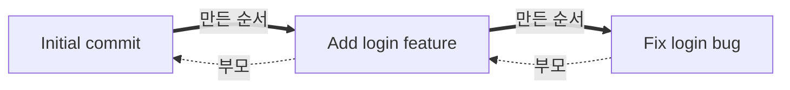

- 굵은 화살표 : 만든 순서 (왼쪽이 먼저)
- 점선 화살표 : 부모 참조 (자식이 부모의 hash를 저장)
  - `Initial commit`의 부모 : 첫 커밋이라 부모가 없음
  - `Add login feature`의 부모 : `Initial commit`
  - `Fix login bug`의 부모 : `Add login feature`
- 만든 순서와 부모 화살표가 반대 방향인 이유 : 새 커밋은 이미 있는 커밋만 가리킬 수 있음

#### commit의 처리 흐름
`commit "Add login"` 입력 시

```text
1. run()            input("mini-git> ")으로 한 줄 읽기 (exit / quit이면 종료)
2. execute()        try로 감싸서 에러가 나도 메시지만 출력하고 계속 진행
3. parse()          shlex.split으로 따옴표 묶어서 나누기 → ["commit", "Add login"]
                    명령어는 소문자로 변환 → 대소문자 구분 없음
4. handlers         "commit" → cmd_commit 찾기 (없으면 Unknown command)
5. cmd_commit()     인자가 정확히 1개인지 확인 (아니면 Invalid args)
6. Repository.commit()
     ├─ INIT 여부 확인
     ├─ 현재 브랜치가 가리키는 커밋을 부모로 지정 (첫 커밋이면 부모 없음)
     ├─ 겹치지 않는 7자리 hash 생성
     ├─ commits[hash]에 저장
     ├─ 현재 브랜치 이름표를 새 커밋으로 이동
     └─ 키워드 / 작성자 역색인에 등록
7. cmd_commit()     "[main 3fa91c2] Add login" 문자열 생성
8. run()            출력 후 다시 프롬프트
```

### 브랜치와 HEAD

| 개념 | 정의 | 쉬운 설명 | 예시 |
|---|---|---|---|
| 브랜치 | 특정 커밋을 가리키는 이름(포인터) | 커밋에 붙이는 이름표 | `main → 78ca51e`<br>`feature → 15809e9` |
| HEAD | 현재 작업 중인 브랜치를 가리키는 포인터 | 지금 내가 있는 브랜치 | `HEAD → main`<br>(`BRANCH` 목록에서 `* main`으로 표시) |

- 과제 요구 : `INIT`은 `main` 브랜치 생성 및 HEAD 설정, `BRANCH`는 현재 커밋을 가리키는 새 브랜치 생성, `SWITCH`는 HEAD를 지정한 브랜치로 이동
- 구현 : `repository.py`
  - `branches = {브랜치 이름: 커밋 hash}`
  - `head = "main"` (현재 브랜치 이름)
  - `head`에 hash가 아니라 **브랜치 이름**을 저장한 이유 : 커밋할 때 `branches[head]`만 바꾸면 브랜치가 자동으로 새 커밋으로 따라감

**그림 : 커밋 → 브랜치 → HEAD (왼쪽부터 만든 순서)**

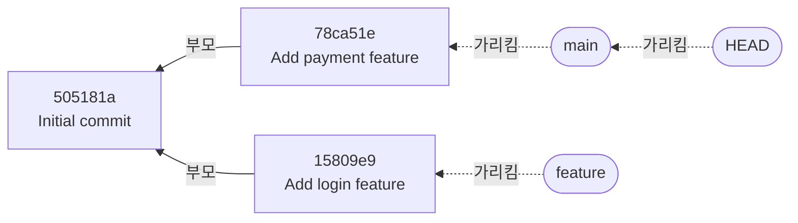

- 실선 : 커밋의 부모 / 점선 : 이름표가 가리키는 대상
- 만들어지는 순서

  | 순서 | 명령 | 생기거나 바뀌는 것 |
  |---|---|---|
  | 1 | `init "Alice"` | `main` 브랜치 (아직 가리킬 커밋 없음), `HEAD → main` |
  | 2 | `commit "Initial commit"` | 커밋 `505181a`, `main → 505181a` |
  | 3 | `branch feature` | `feature → 505181a` (지금 커밋을 같이 가리킴) |
  | 4 | `switch feature` | `HEAD → feature` |
  | 5 | `commit "Add login feature"` | 커밋 `15809e9`, `feature → 15809e9` |
  | 6 | `switch main` | `HEAD → main` |
  | 7 | `commit "Add payment feature"` | 커밋 `78ca51e`, `main → 78ca51e` |

- 정리
  - `INIT` 때 `main`과 HEAD가 먼저 생기지만, 커밋이 생기기 전까지 `main`은 빈 이름표
  - 커밋하면 → 현재 브랜치(HEAD가 가리키는 브랜치)가 새 커밋으로 옮겨감
  - `BRANCH` → 지금 커밋에 이름표를 하나 더 붙임
  - `SWITCH` → HEAD만 다른 이름표로 옮김 (커밋은 그대로)

---

## 3. 사용한 자료구조

- 자료구조 : 데이터를 담는 모양 (모양에 따라 찾기·넣기 속도가 달라짐)
- 3·4장 예시 상황 : `Initial commit` 이후 `main`은 결제 기능, `feature`는 로그인 기능을 만든 뒤 merge

  | 커밋 | hash |
  |---|---|
  | Initial commit | `505181a` |
  | Add login feature | `15809e9` |
  | Add payment feature | `78ca51e` |
  | Merge branch 'feature' | `e7a1f20` |

- O(1), O(N) 같은 표기는 [시간복잡도](#시간복잡도-big-o) 참고

### 3-1. 그래프 / DAG

- 파일 : [minigit/commit.py](minigit/commit.py), [minigit/graph.py](minigit/graph.py)
- 쓰인 곳 : `커밋의 parents`, `LOG`, `PATH`, `ANCESTORS`, `MERGE`

| 개념 | 한 줄 설명 |
|---|---|
| 그래프 (Graph) | 점(Node)과 선(Edge)으로 그린 관계도 |
| DAG (Directed Acyclic Graph) | 화살표가 한쪽으로만 흐르고, 따라가도 제자리로 돌아오지 않는 그래프 |

- 과제 요구 : 커밋은 부모를 0개 이상 가질 수 있고, 커밋 그래프는 DAG
- 구현 : 커밋마다 `parents`에 부모 hash를 저장 → 이 화살표들이 모여 그래프가 됨

<br>

#### 커밋 구조가 DAG인 이유

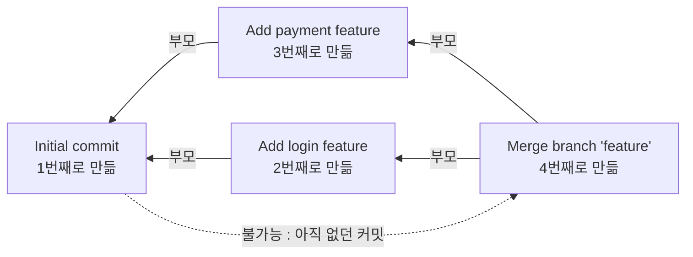

| 조건 | 커밋에서 | 이유 |
|---|---|---|
| 방향 있음 (Directed) | 화살표는 항상 자식 → 부모 | 새 커밋을 만들 때 자식은 아직 없음 |
| 순환 없음 (Acyclic) | 따라가면 반드시 `Initial commit`에서 끝남 | 옛 커밋이 새 커밋을 가리킬 수 없음 (그림의 점선) |
| 부모 여러 개 (Graph) | merge 커밋은 부모 2개 | 부모가 1개뿐인 트리로는 표현 불가 |

<br>

#### 다른 자료구조도 있는데 DAG를 쓴 이유?

| 자료구조 | 커밋 기록에 쓰면 |
|---|---|
| **DAG** | ✅ 갈라지기 + 합치기 + 순서 유지 |
| 리스트 | ❌ 한 줄로만 이어져서 브랜치가 갈라지는 모습을 표현 못 함 |
| 트리 | ❌ 부모가 1개뿐이라 merge 커밋을 표현 못 함 |
| 순환 있는 그래프 | ❌ 아래처럼 순서가 깨짐 |

<br>

#### 순환이 생기면 안 되는 이유 (그림 : 순환이 있는 커밋 그래프 예시)

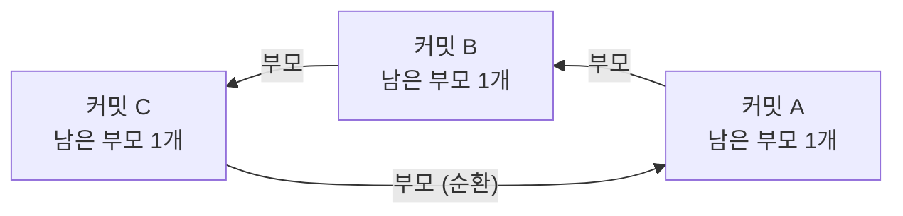


  | 기능 | 순환이 있으면 |
  |---|---|
  | 기록 | A가 B의 부모이면서 B가 A의 부모 → "누가 먼저"가 사라짐 |
  | `LOG` | "부모 먼저" 순서를 만들 수 없음 |
  | `ANCESTORS` | 같은 커밋을 계속 돌거나, 자기 자신이 자기 조상이 됨 |

- `topological_sort()`가 순환을 만나면 `Commit graph has a cycle` 에러를 던짐

<br>

### 3-2. 해시맵 (`dict`)

- 파일 : [minigit/repository.py](minigit/repository.py), [minigit/index.py](minigit/index.py), [minigit/cli.py](minigit/cli.py)
- 쓰인 곳 : `hash → 커밋`, `브랜치 → 커밋`, `단어 → 커밋 목록`, `명령어 → 처리 함수`
- 한 줄 설명 : 키(Key)만 알면 값(Value)을 바로 꺼내는 사물함 (찾기 `O(1)`)
- 과제 요구 : 커밋 hash로 빠르게 찾기, hash는 세션 안에서 중복 금지

  | 변수 | 모양 | 하는 일 |
  |---|---|---|
  | `commits` | `{hash: 커밋}` | hash로 커밋 바로 찾기 |
  | `branches` | `{브랜치 이름: hash}` | 브랜치가 가리키는 커밋 |

<br>

그림 : hash로 커밋 바로 찾기 (dict 조회 O(1))
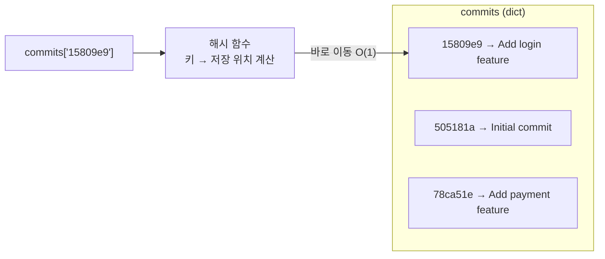

- 그림의 "해시 함수"는 파이썬 `dict`가 키 자리를 찾는 내부 동작 → 아래 커밋 hash(SHA-1)와는 다른 것

- hash 생성
  - 커밋 정보를 SHA-1(Secure Hash Algorithm 1)에 넣고 앞 7자리 사용
- 중복 방지
  - 커밋마다 늘어나는 번호를 같이 넣어 해싱 → 같은 메시지를 같은 초에 커밋해도 입력이 다름
  - 그래도 겹치면 재시도 번호(nonce)를 바꿔 다시 해싱
  - 테스트 : 같은 메시지로 2,000번 커밋 → hash 2,000개 모두 다름 (`test_hashes_unique`)
 
<br>
 
### 3-3. 큐 (Queue) / 덱 (Deque)

- 파일 : [minigit/graph.py](minigit/graph.py)
- 쓰인 곳 : `LOG 위상 정렬`, `PATH BFS`, `ANCESTORS BFS`

| 개념 | 한 줄 설명 |
|---|---|
| 큐 (Queue) | 먼저 넣은 것이 먼저 나오는 줄 (FIFO, First In First Out) |
| 덱 (Deque, Double-Ended Queue) | 앞·뒤 양쪽에서 넣고 뺄 수 있는 줄 |

- 구현 : 파이썬 `collections.deque`를 `append()`(뒤에 넣기) + `popleft()`(앞에서 꺼내기)로만 써서 큐로 사용
- `list` 대신 쓴 이유 : 앞에서 꺼낼 때 `list`는 나머지를 한 칸씩 당겨서 O(N), `deque`는 O(1)

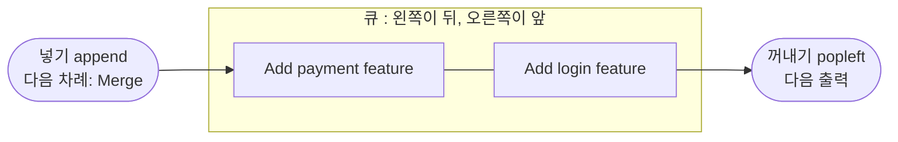

- 위상 정렬에서 `Initial commit`을 꺼낸 직후의 큐 ([4-1](#4-1-위상-정렬--log) 표의 1단계)
 
<br>
 
### 3-4. 집합 (`set`)

- 파일 : [minigit/graph.py](minigit/graph.py), [minigit/index.py](minigit/index.py)
- 쓰인 곳 : `ANCESTORS 방문 기록`, `역색인 중복 등록 방지`, `SEARCH 여러 단어 교집합`
- 한 줄 설명 : 같은 값을 두 번 담지 않는 주머니 (들어 있는지 확인 O(1))
- 구현 : `find_ancestors()`의 `visited`에 본 커밋을 기록 → 다시 만나면 건너뜀

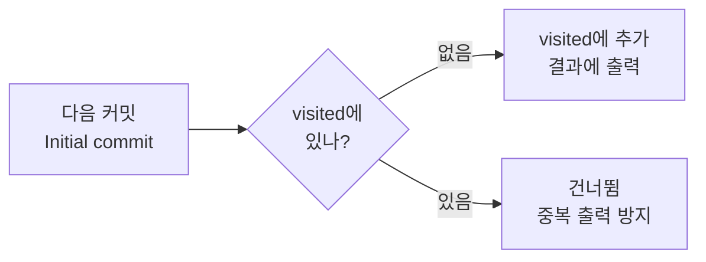

- 예 : `Merge`의 조상을 찾을 때 `Initial commit`을 두 갈래에서 만나지만 한 번만 출력
 
<br>
 
### 3-5. 역색인

- 파일 : [minigit/index.py](minigit/index.py)
- 쓰인 곳 : `SEARCH <keyword>`, `SEARCH --author=<name>`, `COMMIT 때 갱신`
- 한 줄 설명 : 책 뒤의 "찾아보기"처럼 단어 → 커밋 목록을 미리 만들어 둔 표
- 과제 요구
  - 모든 커밋을 훑지 않고 검색
  - 메시지를 공백으로 자르고 소문자로 바꾼 단어를 저장
  - `keyword → hash 목록`, `author → hash 목록` 2종
- 구현 : `InvertedIndex`(키 → hash 목록), `SearchIndex`(키워드용 + 작성자용 2개를 묶음)

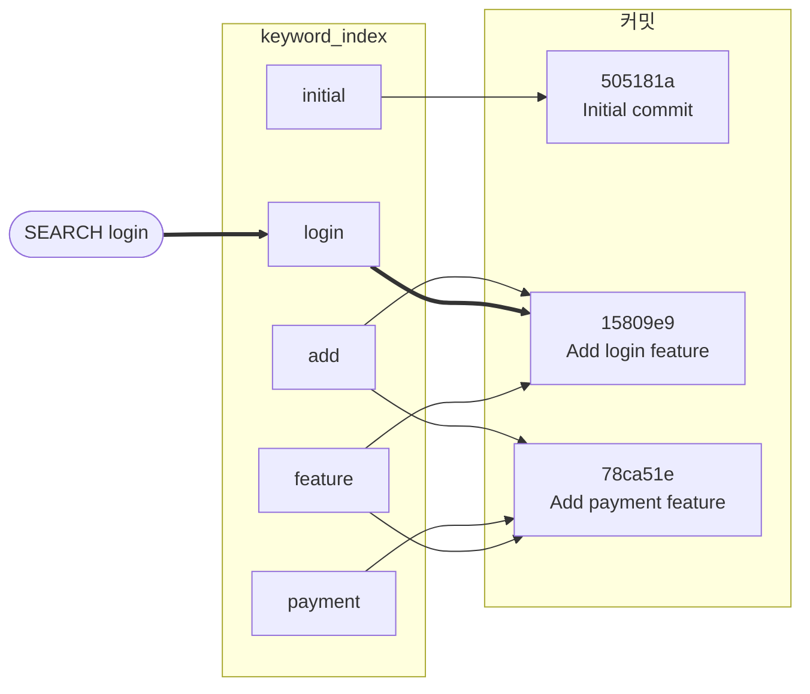

- 커밋할 때 : `"Add login feature"` → `add` / `login` / `feature` 칸에 hash 등록
- 검색할 때 : `login` 칸만 열면 끝 (다른 커밋은 안 봄)
- 왜 빠른가

  | 방법 | 하는 일 | 시간복잡도 |
  |---|---|---|
  | 전체 훑기 | 모든 커밋 메시지를 하나씩 확인 | O(N × 메시지 길이) |
  | 역색인 | `dict`에서 단어로 한 번 조회 | O(1) + 결과 수 |

- 갱신 시점 : `repository.py`의 `_create_commit()` 마지막 단계
  - `COMMIT`, `MERGE` 둘 다 여기를 지나감 → 갱신 위치가 한 곳이라 빠뜨릴 일 없음
  - 목록 끝에 붙이기만 함 → 검색 결과가 만든 순서대로 나옴
- 규칙 : 대소문자 무시, 단어 단위 일치(`log`로 `login`은 못 찾음), 여러 단어는 모두 들어간 커밋만
- 처리 흐름

  ```text
  SEARCH <keyword>         → 소문자로 바꿔 keyword_index 조회 (여러 단어면 교집합)
  SEARCH --author=<name>   → author_index 조회
  ```

---

## 4. 사용한 알고리즘

- 알고리즘 : 문제를 푸는 순서와 방법
- 요약 표는 [1-3. 사용한 자료구조](#1-3-사용한-자료구조), [1-4. 사용한 알고리즘](#1-4-사용한-알고리즘)
 
<br>
 
### 시간복잡도 (Big-O)

- 한 줄 설명 : 데이터가 늘어날 때 프로그램이 얼마나 느려지는지 나타낸 표기
- 기호

  | 기호 | 풀네임 | 이 과제에서 |
  |---|---|---|
  | N | Number (개수) | 정렬·검색할 데이터 개수 |
  | V | Vertex (정점, 그래프의 점) | 커밋 수 |
  | E | Edge (간선, 그래프의 선) | 부모 연결 수 |
  | M | 두 번째 입력의 개수 | `DIFF`에서 두 번째 파일의 줄 수 |

- 표기별 비교

  | 표기 | 데이터가 2배가 되면 | 예 |
  |---|---|---|
  | O(1) | 그대로 | `dict`에서 키로 찾기 |
  | O(N) | 약 2배 | 리스트 전체 훑기 |
  | O(N log N) | 2배 조금 넘게 | 병합 정렬 |
  | O(N²) | 약 4배 | 삽입 정렬 |
  | O(V + E) | 커밋 수 + 연결 수만큼 | 모든 커밋과 연결을 한 번씩만 봄 (BFS, 위상 정렬) |

- log N : N을 반으로 몇 번 나눠야 1이 되는지 (N = 1,024면 10번)
 
<br>
 
### 4-1. 위상 정렬 — `LOG`

- 파일 : [minigit/graph.py](minigit/graph.py) `topological_sort()`
- 쓰인 곳 : `LOG`
- 한 줄 설명 : "부모가 먼저" 같은 순서 조건을 지키며 줄 세우기 (선수과목부터 듣는 수강 순서처럼)
- 과제 요구 : 최신순이 아니라 부모 커밋이 항상 자식보다 먼저 출력
- 시각 순으로 안 한 이유 : 같은 초에 만든 커밋은 시각으로 구분 못 함 → 부모 관계만 보고 정해야 항상 맞음
- 구현 (Kahn 알고리즘 : 큐로 위상 정렬을 하는 대표 방법)
  1. 커밋마다 "아직 출력 안 된 부모 수"를 셈
  2. 0인 커밋을 큐에 넣음
  3. 하나 꺼내 출력 → 그 자식들의 수를 1씩 줄임
  4. 0이 된 자식을 큐에 넣음 → 큐가 빌 때까지 반복

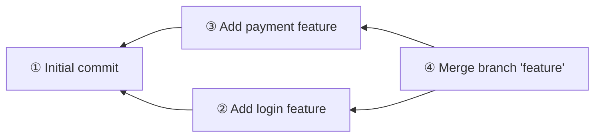

- 번호 = `LOG`에 나오는 순서

  | 단계 | 출력 | 남은 부모 수 (바뀐 것만) | 큐 |
  |---|---|---|---|
  | 시작 | - | Initial 0, login 1, payment 1, Merge 2 | [Initial] |
  | 1 | Initial commit | login 0, payment 0 | [login, payment] |
  | 2 | Add login feature | Merge 1 | [payment] |
  | 3 | Add payment feature | Merge 0 | [Merge] |
  | 4 | Merge branch 'feature' | - | [] |

- Merge는 부모 **둘 다** 출력된 뒤에야 큐에 들어감
- 전부 출력하지 못하면 순환이 있다는 뜻 → 에러
- 처리 흐름

  ```text
  LOG [--sort-by=date|author]
    ├─ graph.topological_sort()로 부모 먼저 순서 만들기
    ├─ 옵션 없음 → 그대로 출력
    └─ --sort-by → merge_sort()로 다시 정렬 (4-4)
  ```
 
<br>
 
### 4-2. BFS 최단 경로 — `PATH`

- 파일 : [minigit/graph.py](minigit/graph.py) `shortest_path()`
- 쓰인 곳 : `PATH`
- 한 줄 설명 : BFS(Breadth-First Search, 너비 우선 탐색) = 가까운 곳부터 한 칸씩 넓혀 가며 찾기 → 처음 도착한 길이 최단 경로
- 과제 요구
  - 부모 연결을 방향 없는 선으로 보고, 지나가는 선이 가장 적은 경로
  - 없으면 `No path`, 여러 개면 `hash1->hash2->...` 문자열이 사전순으로 가장 작은 경로
  - 사전순 : 사전에서 앞에 오는 순서, 앞 글자부터 비교 (`0` < `9` < `a` < `f`라서 `505181a` < `e7a1f20`)
- 방향 없는 선으로 본 이유 : 과제 정의이기도 하고, 그래야 다른 브랜치의 형제 커밋(같은 부모에서 갈라진 커밋)끼리도 거리를 잴 수 있음 (부모 방향만 허용하면 → [조건 변경 실험 2](docs/condition-change.md#2-path를-부모-방향만-허용하면))
- 구현
  1. 도착점에서 BFS → 모든 커밋의 "도착까지 남은 칸 수" 계산
  2. 출발점부터 남은 칸 수가 1 줄어드는 이웃 중 **hash가 가장 작은 것**으로 이동

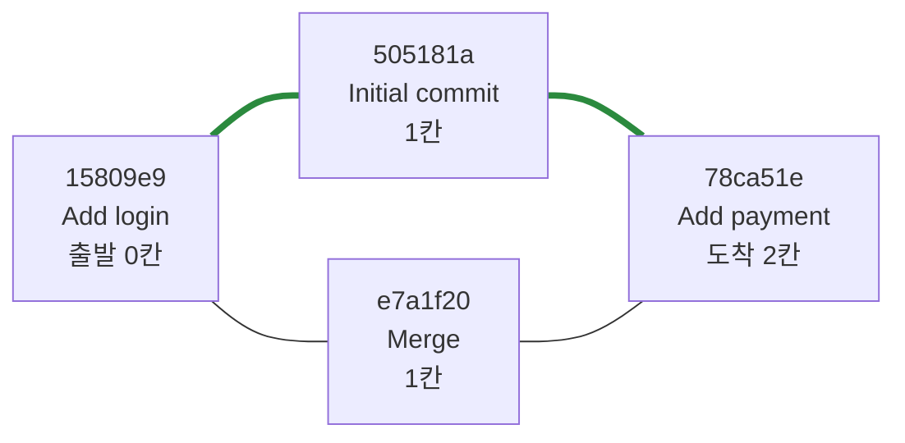

- 예시 그래프 : 3장 첫머리 표의 merge까지 끝난 상태 (시연 그래프와 다름)
- `PATH 15809e9 78ca51e` : 최단 경로 2개 (둘 다 2칸)
  - `15809e9 -> 505181a -> 78ca51e` ← 선택 (`505181a` < `e7a1f20`)
  - `15809e9 -> e7a1f20 -> 78ca51e`
- 매번 가장 작은 hash만 고르면 되는 이유 : hash가 모두 7자라 경로 문자열 비교 = 앞 hash부터 차례로 비교
- `No path` : CLI에서는 모든 커밋이 첫 커밋과 이어져 있어 안 나옴 → 끊긴 그래프를 직접 만들어 테스트 (`test_shortest_path_same_and_none`)
- 없는 hash를 넣으면 `No path`가 아니라 `Unknown commit: <hash>`
 
<br>
 
### 4-3. BFS 조상 탐색 — `ANCESTORS`

- 파일 : [minigit/graph.py](minigit/graph.py) `find_ancestors()`
- 쓰인 곳 : `ANCESTORS`, `MERGE`의 `Already up to date.` 판정
- 한 줄 설명 : 부모 → 부모의 부모 → … 끝까지 따라가 모두 모으기
- 과제 요구 : 도달 가능한 모든 조상을 빠짐없이 출력
- 구현 : 부모 방향으로만 BFS, 본 커밋은 `set`에 기록해 한 번만 출력

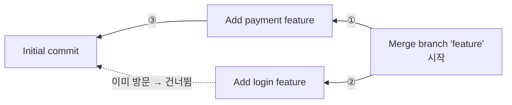

- 결과 : `Add payment feature`, `Add login feature`, `Initial commit` (3개, 중복 없음)
 
<br>
 
### 4-4. 정렬 — `LOG --sort-by`

- 파일 : [minigit/sorting.py](minigit/sorting.py) `merge_sort()`, [minigit/repository.py](minigit/repository.py) `log()`
- 쓰인 곳 : `LOG --sort-by=date`, `LOG --sort-by=author`

| 개념 | 한 줄 설명 |
|---|---|
| 정렬 | 기준(key)에 맞춰 줄 세우기 |
| 안정 정렬 | 기준값이 같으면 원래 순서 그대로 두는 정렬 |

- 과제 요구 : `sorted()`, `list.sort()` 금지 → 직접 구현, 기준을 바꿔 정렬 가능
- 구현 : `merge_sort()`가 기준을 `key` 함수로 받음 → `log()`가 날짜면 `timestamp`, 작성자면 `author`를 넘김

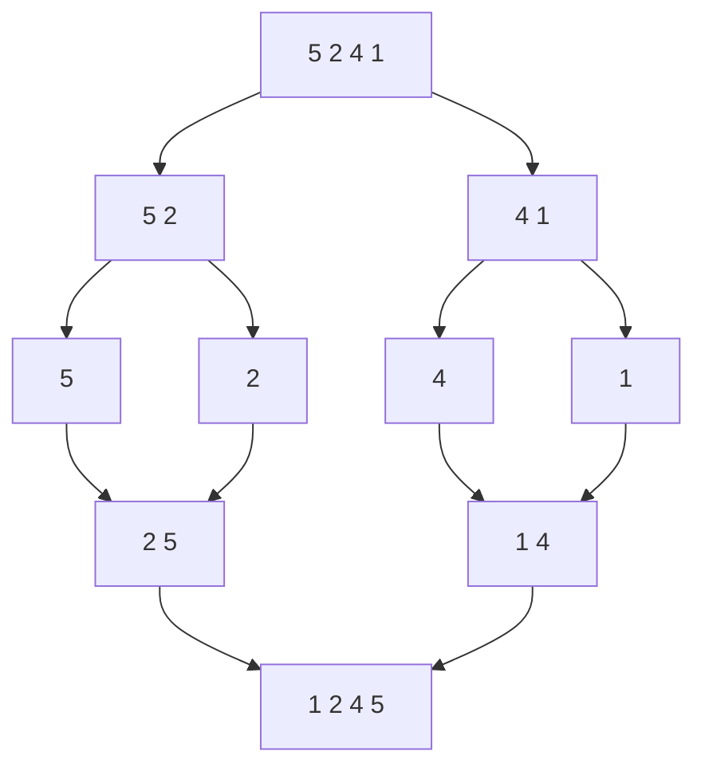

- 병합 정렬 : 반씩 나누고 → 정렬하며 합치기

  | 평균 | 최악 | 안정 정렬 |
  |---|---|---|
  | O(N log N) | O(N log N) | O |

  - O(N log N) : 반씩 나누면 log N 단계, 단계마다 N개를 한 번씩 비교
  - 최악도 같음 : 입력이 어떻든 항상 반씩 나눔
  - 안정 : 합칠 때 값이 같으면 왼쪽(원래 앞에 있던 것)을 먼저 넣음 (`<=` 비교)

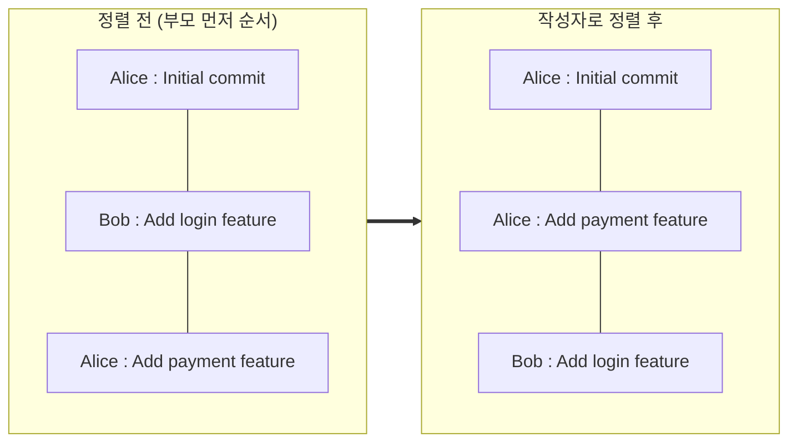

- 안정 정렬 예 : Alice 커밋 2개는 정렬 후에도 원래 순서 그대로 (`Add login feature`만 Bob이라고 가정)
- 병합 정렬을 고른 이유 : 최악에도 O(N log N) + 안정 정렬이라 같은 작성자끼리는 부모 먼저 순서 유지
- 처리 흐름

  ```text
  --sort-by=date   → merge_sort(기준: 만든 시각, 같으면 생성 순서)
  --sort-by=author → merge_sort(기준: 작성자 이름 소문자, 같으면 원래 순서)
  ```

**[보너스] 정렬 알고리즘 성능 비교 — `BENCH`**

- 파일 : [minigit/sorting.py](minigit/sorting.py) `quick_sort()`, `insertion_sort()`, [minigit/benchmark.py](minigit/benchmark.py)
- 과제 요구 : 정렬 2개 이상 구현, 입력 크기별 실행 시간 비교
- 구현 : 같은 난수 데이터로 세 정렬의 실행 시간(ms)을 크기별로 측정

  | 알고리즘 | 동작 | 평균 | 최악 | 안정 정렬 |
  |---|---|---|---|---|
  | 병합 정렬 | 반씩 나눠 정렬 후 합침 | O(N log N) | O(N log N) | O |
  | 퀵 정렬 | 기준값보다 작은 것 / 큰 것으로 나눠 반복 | O(N log N) | O(N²) | X |
  | 삽입 정렬 | 카드 정리하듯 하나씩 알맞은 자리에 끼움 | O(N²) | O(N²) | O |

  - 퀵 정렬 최악 : 기준값이 매번 가장 작거나 큰 값이면 한쪽으로만 나뉨
  - 퀵 정렬 안정성 X : 보통은 자리를 맞바꾸며 같은 값의 순서가 섞임 (이 구현은 작은 / 같은 / 큰 리스트로 나눠서 실제로는 순서 유지)

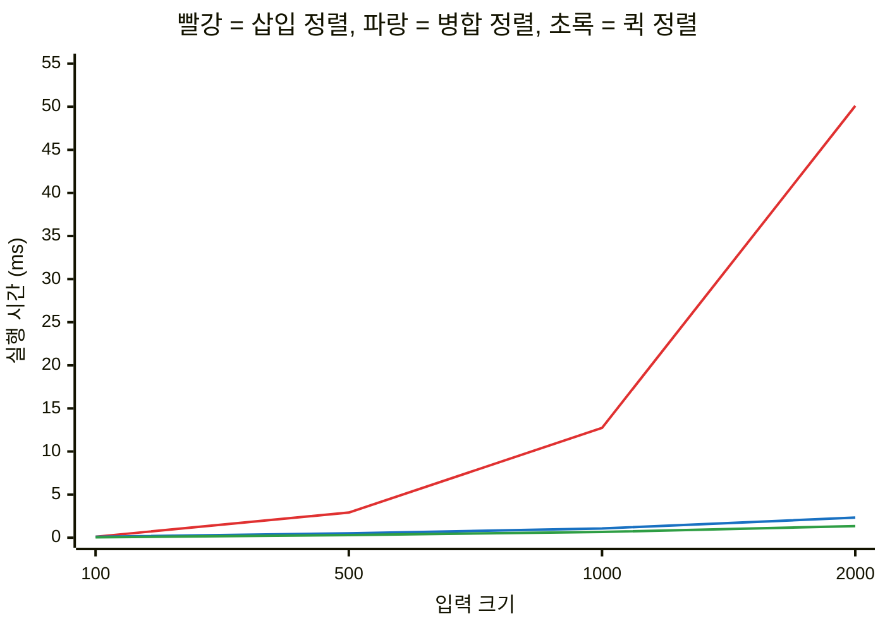

- 크기가 2배가 될 때 삽입 정렬만 약 4배씩 늘어남 → O(N²)
 
<br>
 
### 4-5. [보너스] LCS — `DIFF`

- 파일 : [minigit/diff.py](minigit/diff.py) `diff_lines()`
- 쓰인 곳 : `DIFF <file1> <file2>`
- `LCS`(Longest Common Subsequence, 최장 공통 부분 수열)
  
  : 두 파일에서 순서를 지키며 겹치는 가장 긴 줄 목록
- 과제 요구 : 두 텍스트 파일을 줄 단위로 비교해 추가 / 삭제 / 공통 줄 구분
- 구현 : 작은 구간의 답을 표에 저장해 재사용하는 **동적 계획법**으로 LCS 계산 
  
  → LCS에 있으면 공통, 첫 파일에만 있으면 삭제(`- `), 둘째 파일에만 있으면 추가(`+ `)

**그림 : LCS를 이용한 diff 비교**
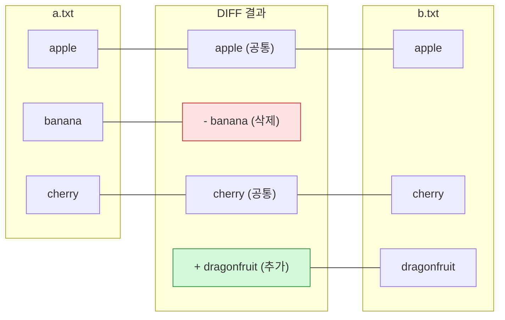

- 이 그림에서 LCS에 해당 하는 것 = `apple`, `cherry`
  - 공통 (Common) : 두 파일 모두에 있는 줄
  - 부분 수열 (Subsequence) : 중간을 건너뛰어도 되지만 순서는 그대로 유지해서 고른 것
  - 최장 (Longest) : 그런 것 중 가장 긴 것
- 코드는 LCS 줄 목록을 따로 저장하지 않고, 길이 표 `lcs[i][j]`만 채운 뒤 앞에서부터 따라가며 공통 / 삭제 / 추가를 바로 출력

<br>
 
### 4-6. [보너스] 병합 커밋 — `MERGE`

- 파일 : [minigit/repository.py](minigit/repository.py) `merge()`, [minigit/graph.py](minigit/graph.py) `is_ancestor()`
- 쓰인 곳 : `MERGE <branch_name>`
- 한 줄 설명 : 두 브랜치의 마지막 커밋을 둘 다 부모로 갖는 커밋 만들기
- 과제 요구 : 현재 브랜치 HEAD와 대상 브랜치 HEAD를 부모로 하는 merge 커밋 생성
- 구현
  - 대상이 이미 현재 커밋의 조상이면 합칠 게 없음 → `Already up to date.`
  - 아니면 `parents = [현재 커밋, 대상 커밋]`인 새 커밋 생성

**그림 : `main`에서 `MERGE feature` 실행 (전 → 후)**

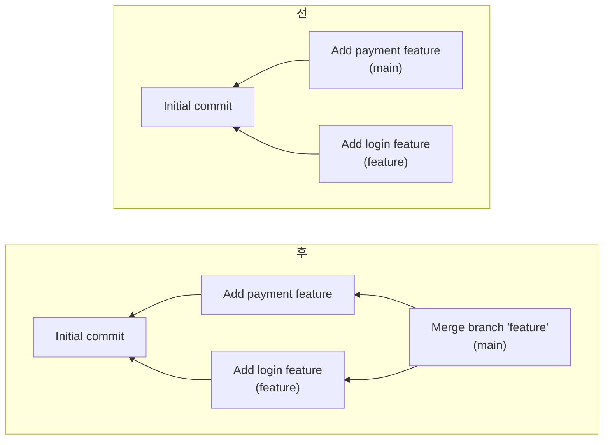


---
 
<br>
 
## 5. 설계

- 3·4장의 자료구조와 알고리즘을 코드에서 어떻게 나눠 담았는지 정리

### 5-1. 프로젝트 구조

#### 계층 구조
- 의존 방향은 위 → 아래 한쪽으로만 흐름 (아래 파일은 위 파일을 모름)

```text
cli.py                             입력 해석, 출력 문자열 생성
   ↓
repository.py                      브랜치·HEAD·커밋 관리, 잘못된 요청이면 에러
   ↓
graph.py / sorting.py / index.py   탐색·정렬·검색 알고리즘만 담당
```

<br>

#### 폴더 구조

```text
Codyssey-B5-2-Mini-Git/
├── main.py                 # 실행 시작점 (Python 버전 확인 후 REPL(Read-Eval-Print Loop, 입력 → 실행 → 출력 반복) 실행)
├── demo.py                 # 시연 자동화 (모든 기능 + 테스트를 한 번에 출력)
├── README.md
├── docs/                   # 동료평가 준비 자료 (예상 질문과 답변, 브라우저용 시각화)
├── minigit/
│   ├── commit.py           # 커밋 데이터 정의
│   ├── repository.py       # 저장소 상태 (커밋 dict, 브랜치, HEAD, 사용자, hash 생성, merge)
│   ├── graph.py            # 위상 정렬, 최단 경로, 조상 탐색
│   ├── sorting.py          # 병합 / 퀵 / 삽입 정렬
│   ├── index.py            # 역색인 (키워드, 작성자)
│   ├── cli.py              # 입력 해석, 명령 실행, 결과 출력
│   ├── diff.py             # (보너스) 줄 단위 비교
│   └── benchmark.py        # (보너스) 정렬 속도 비교
└── tests/
    └── test_minigit.py     # 단위 테스트
```

<br>

### 5-2. 상태는 어떻게 나눴나?

- 결론 : 저장소 상태 5가지를 `Repository` 한 곳에 모으고, 값은 `Repository` 메서드로만 바꿈
- 이유 : 상태가 바뀌는 길이 하나뿐이라 "브랜치는 옮겨졌는데 HEAD는 그대로" 같은 어긋남이 생기지 않음

| 상태 | 구조 | 맡은 일 |
|---|---|---|
| 커밋 저장소 `commits` | `dict[hash, Commit]` | 모든 커밋 보관, hash로 O(1) 조회 |
| 브랜치 `branches` | `dict[브랜치 이름, hash]` | 브랜치마다 가리키는 커밋 하나 |
| HEAD `head` | `str` (브랜치 이름) | 지금 있는 브랜치 = 새 커밋이 붙을 곳 |
| 사용자 `user` | `str` | 다음 커밋의 작성자 |
| 역색인 `index` | `SearchIndex` | 키워드 · 작성자 검색 |

- 브랜치는 커밋을 복사하지 않고 hash만 가리킴 → 브랜치를 만들어도 커밋 데이터는 늘지 않음
- HEAD는 커밋이 아니라 브랜치 이름을 가리킴 → 커밋하면 브랜치만 앞으로 옮기면 HEAD도 같이 따라감
- 커밋 하나의 데이터는 `commit.py`의 `Commit`이 담당 (동작 없이 데이터만)

<br>

### 5-3. 그래프 탐색은 어떻게 재사용하나?

- 결론 : 탐색 함수는 그래프(`dict[hash, Commit]`)만 받고 hash 목록만 돌려줌
- 이유 : 저장소 상태, 출력 형식, 에러 메시지를 모르니 어느 명령에서든 그대로 가져다 쓸 수 있음

| 공통으로 쓰는 탐색 (`graph.py`) | 쓰는 명령 |
|---|---|
| 자식 목록 만들기 `build_children()` | `LOG` (위상 정렬) |
| 무방향 이웃 + BFS 거리 `_undirected_neighbors()`, `_bfs_distances()` | `PATH` (최단 경로) |
| 조상 찾기 `find_ancestors()` | `ANCESTORS`, `MERGE` (이미 합쳐졌는지 판정) |

- 역할 나누기
    - 없는 hash인지 확인 → `Repository.get_commit()`
    - 결과를 글자로 출력 → `cli.py`
    - 탐색 자체 → `graph.py`
- 덕분에 테스트에서 저장소 없이 가짜 그래프(`make_graph()`)를 바로 넣어 시험함 (순환 그래프, 연결 안 된 그래프 포함)

<br>

### 5-4. 주석 작성 기준

- 결론 : "무엇을 하는지"는 docstring, "이 줄이 왜 있는지"는 한 줄 주석
- 이유 : 처음 보는 사람이 파일 → 함수 → 줄 순서로 내려가며 읽을 수 있게

| 위치 | 쓰는 것 | 예 |
|---|---|---|
| 파일 맨 위 | 파일이 맡은 일 한 줄 (모든 파일) | `repository.py` : "저장소 상태 관리: 커밋 저장소, 브랜치, HEAD, 현재 사용자." |
| 알고리즘 함수 | 하는 일 + 단계 + 시간복잡도 | `topological_sort()` : Kahn 알고리즘 4단계, O(V + E) |
| 저장소 · 역색인 메서드 | 하는 일 + 실패하면 나는 에러 | `get_commit()` : "없으면 Unknown commit 에러" |
| 코드 한 줄마다 | 그 줄이 하는 일을 쉬운 말로 | `dist[nxt] = dist[current] + 1  # 거리 = 현재 거리 + 1` |

- docstring을 생략한 곳 : `cmd_*` 명령 처리 함수, `__init__`
  - 이름만으로 역할이 분명하고(`cmd_path` = PATH 명령), 줄마다 주석이 있어서 같은 설명을 반복하지 않음

<br>

### 5-5. 과제에서 자유로 둔 부분의 결정

| 항목 | 결정 | 이유 |
|---|---|---|
| hash 형식 | SHA-1 앞 7자리 | 실제 Git 짧은 hash와 비슷, 길이가 같아야 경로 사전순 비교가 단순 |
| LOG 범위 | 모든 브랜치의 커밋 | 과제 예시 출력과 동일 |
| LOG의 `[main]` | 커밋을 만들 때의 브랜치 | 과제 예시 출력과 동일 |
| 날짜 정렬 동률 | 생성 순서 | 같은 초에 만든 커밋도 순서 결정 |
| 작성자 정렬 동률 | 원래 순서(부모 먼저) 유지 | 병합 정렬이 안정 정렬 |
| 커밋 전 BRANCH | 에러 | 가리킬 커밋이 없음 (실제 Git도 동일) |
| 따옴표 없는 공백 메시지 | `Invalid args` | 과제의 따옴표 규칙을 그대로 적용 |
| 이미 합친 브랜치 MERGE | `Already up to date.` | 대상이 이미 조상이면 합칠 내용 없음 |

<br>

<br>

## 6. 예외 처리

```text
잘못된 입력 → `MiniGitError` 발생 → `execute()`에서 잡아 메시지만 출력
```

어떤 입력이 와도 프로그램이 멈추지 않고 다음 입력을 받음

<br>

| 상황 | 입력 예 | 출력 |
|---|---|---|
| 인자가 없거나 너무 많음 | `commit` | `Invalid args` |
| 공백이 있는데 따옴표 없음 | `commit Add login` | `Invalid args` |
| 따옴표를 닫지 않음 | `commit "unclosed` | `Invalid args` |
| 잘못된 옵션 | `log --sort-by=size` | `Invalid args` |
| 없는 브랜치 | `switch nope` | `Unknown branch: nope` |
| 없는 커밋 | `ancestors zzz` | `Unknown commit: zzz` |
| 없는 명령어 | `hello` | `Unknown command: hello` |
| INIT 전에 다른 명령 | `log` | `Not initialized. Use INIT <user_name> first` |
| 이미 있는 브랜치 이름 | `branch main` | `Branch already exists: main` |
| 커밋이 하나도 없음 | `branch x`, `log` | `No commits yet` |
| 현재 브랜치를 자기 자신과 merge | `merge main` | `Cannot merge a branch into itself` |
| 없는 파일로 diff | `diff a.txt nope.txt` | `Cannot read file: nope.txt` |
| bench에 숫자가 아닌 값 | `bench abc` | `Invalid args` |
| 빈 줄 | (엔터) | 출력 없음 |
| Ctrl+D, Ctrl+C | | 정상 종료 |

---
 
<br>
 
## 7. 조건 변경 실험

- 규모나 규칙이 바뀌면 어디가 문제가 되고 무엇을 고치면 되는지 따로 정리 → [docs/condition-change.md](docs/condition-change.md)

| 바뀌는 조건 | 핵심 영향 | 바꿀 코드 |
|---|---|---|
| [커밋이 10배로 늘어나면](docs/condition-change.md#1-커밋이-10배로-늘어나면) | 대부분 O(V + E)라 시간도 약 10배, 매번 다시 만드는 표가 병목 | `graph.py` 증분 갱신 |
| [`PATH`를 부모 방향만 허용하면](docs/condition-change.md#2-path를-부모-방향만-허용하면) | 형제 커밋끼리는 `No path`, `PATH A B` ≠ `PATH B A` | `graph.py`의 `shortest_path()` |
| [작성자 정렬에서 "부모 먼저"도 지켜야 하면](docs/condition-change.md#3-작성자-정렬에서-부모-먼저도-지켜야-하면) | 큐를 최소 힙으로 바꾼 우선순위 위상 정렬, O((V + E) log V) | `graph.py`, `sorting.py` |
| [hash 생성 방식을 바꾸면](docs/condition-change.md#4-hash-생성-방식을-바꾸면) | 테스트 고정값 비교 가능 여부, `PATH` 동률 결과의 재현성 | `repository.py`, 테스트 |

- 증분 갱신 : 매번 처음부터 다시 만들지 않고, 바뀐 부분만 조금씩 고치기
- 최소 힙 : 가장 작은 값을 항상 맨 위에 두는 자료구조 (넣기·꺼내기 O(log N))

---
 
<br>
 
## 8. 테스트

```bash
python -m unittest discover tests -v
```

- `python demo.py`의 마지막 장면에서도 같은 테스트를 실행

- 총 23개 테스트

| 분야 | 확인 내용 |
|---|---|
| 정렬 | 세 알고리즘 결과 일치, 기준 변경, 안정 정렬, 소스에 `sorted()` / `.sort()` 없음 |
| 그래프 | 부모 먼저 출력, 최단 경로 사전순, 형제 커밋 경로, `No path`, 조상 중복 없음, 순환 감지 |
| 역색인 | 대소문자 무시, 여러 단어 검색, 작성자 검색 |
| 저장소 | 커밋·브랜치 연결, 에러 처리, hash 2,000개 중복 없음, 정렬, merge |
| CLI | 따옴표 처리, 과제 예시 시나리오, 출력 형식, 에러 메시지 |
| 보너스 | diff 결과, 없는 파일 처리 |
