# Mini Git

Codyssey B5-2 과제 **"파일이 언제 어떻게 바뀌었는지 기록하는 작은 프로그램 만들기"**

- Git이 커밋을 저장하고 찾는 방식을 직접 구현한 CLI 프로그램
- 파일 내용은 다루지 않고 커밋 정보(작성자, 시각, 메시지, 부모 커밋)만 기록
- 데이터는 **실행 중인 파이썬 프로그램의 RAM(메인 메모리)** 에만 저장
  - 커밋·브랜치는 파이썬 객체(`dict`, `list`)로만 존재하고, 파일이나 DB에는 저장하지 않음
  - 그래서 `exit`으로 프로그램(파이썬 프로세스)이 종료되면 모두 사라짐
  - 과제 제약: "데이터 영속성(파일 저장)은 구현하지 않아도 된다(메모리 상 동작으로 충분)"
- 평가 예상 질문은 [docs/peer-review-qna.md](docs/peer-review-qna.md)에 정리

## 목차

1. [과제 소개](#1-과제-소개)
2. [배경 지식](#2-배경-지식)
3. [사용한 자료구조](#3-사용한-자료구조)
4. [사용한 알고리즘](#4-사용한-알고리즘)
5. [실행 방법](#5-실행-방법)
6. [기능](#6-기능)
7. [시연](#7-시연)
8. [프로젝트 구조](#8-프로젝트-구조)
9. [명령어 처리 흐름](#9-명령어-처리-흐름)
10. [예외 처리](#10-예외-처리)
11. [요구사항 체크리스트](#11-요구사항-체크리스트)
12. [테스트](#12-테스트)

---

## 1. 과제 소개

**목표**: Git 커밋 안에 있는 그래프 자료구조와 해시를 직접 구현하며 이해하기

**과제를 마치고 설명할 수 있어야 하는 것**

| # | 설명할 수 있어야 하는 것 | README 위치 |
|---|---|---|
| 1 | Git의 커밋 구조가 왜 **DAG**인지 | [3-1. 그래프 / DAG](#3-1-그래프--dag) |
| 2 | 부모가 먼저 나오는 로그에 왜 **위상 정렬**이 필요한지 | [4-1. 위상 정렬](#4-1-위상-정렬--log) |
| 3 | 두 커밋 사이 **최단 경로**와 **모든 조상**을 찾는 방법 | [4-2. BFS 최단 경로](#4-2-bfs-최단-경로--path), [4-3. 조상 탐색](#4-3-bfs-조상-탐색--ancestors) |
| 4 | 직접 구현한 **정렬 알고리즘**의 시간복잡도와 안정 정렬 여부 | [4-4. 정렬](#4-4-정렬--log---sort-by) |
| 5 | **역색인**이 전체 순회 검색보다 빠른 이유 | [3-5. 역색인](#3-5-역색인) |

**각 개념 설명은 아래 순서로 정리**

- 정의 / 요약 → 과제 요구 → 구현 (어느 파일에 무엇을 어떻게) → 세부 설명
- 선택 과제는 제목과 표에 **[보너스]** 로 표시
- 과제 요구사항별 README 위치는 [11. 요구사항 체크리스트](#11-요구사항-체크리스트)에 정리

---

## 2. 배경 지식

### 커밋

- 정의 : 특정 시점의 작업 상태를 저장한 기록 (작성자·시각·메시지·부모 커밋 정보를 함께 담음)
- 요약 : 작업 내용을 저장한 기록 한 장, 각 커밋은 자기 바로 앞 커밋(부모)을 기억
- 과제 요구 : 커밋 노드는 최소 `hash`, `message`, `author`, `timestamp`, `parents` 필드를 가짐
- 구현 : `commit.py`의 `Commit` 데이터클래스 (필수 필드 + 만든 브랜치 `branch`, 생성 순번 `seq`)
- 예시 : `Add login feature` 커밋 하나를 파이썬 객체로 보면

  ```python
  Commit(
      hash="15809e9",                  # 커밋 고유 번호
      message="Add login feature",     # 커밋 메시지
      author="Alice",                  # 작성자
      timestamp=datetime(2026, 10, 11, 9, 5, 0),  # 만든 시각
      parents=["505181a"],             # 바로 앞 커밋(Initial commit)의 hash
  )
  ```

- 부모 수 : 첫 커밋 0개 / 보통 커밋 1개 / 브랜치를 합친 merge 커밋 2개

### 브랜치와 HEAD

| 개념 | 정의 | 요약 | 예시 |
|---|---|---|---|
| 브랜치 | 특정 커밋을 가리키는 이름(포인터) | 커밋에 붙이는 이름표 | `main → 78ca51e`<br>`feature → 15809e9` |
| HEAD | 현재 작업 중인 브랜치를 가리키는 포인터 | 지금 내가 있는 브랜치 | `HEAD → main`<br>(`BRANCH` 목록에서 `* main`으로 표시) |

- 과제 요구 : `INIT`은 `main` 브랜치 생성 및 HEAD 설정, `BRANCH`는 현재 커밋을 가리키는 새 브랜치 생성, `SWITCH`는 HEAD를 지정한 브랜치로 이동
- 구현 : `repository.py`
  - `branches = {브랜치 이름: 커밋 hash}`
  - `head = "main"` (현재 브랜치 이름)

**그림 : HEAD → 브랜치 → 커밋**

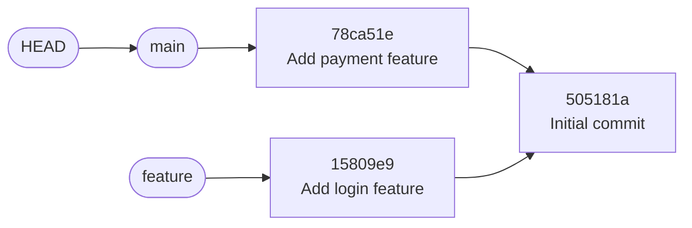

- 동작
  - 커밋하면 → 현재 브랜치(`main`)가 새 커밋을 가리키도록 옮겨감
  - `BRANCH feature` → 지금 커밋을 가리키는 `feature`를 하나 더 만듦
  - `SWITCH feature` → `HEAD`가 `feature`를 가리키도록 바꿈

### 시간복잡도 (Big-O)

- 정의 : 입력 크기(N)가 커질 때 알고리즘의 실행 시간이 늘어나는 정도를 나타낸 것
- 요약 : 데이터가 늘어날 때 프로그램이 얼마나 느려지는지 나타내는 표기
- 표기별 비교

  | 표기 | 데이터가 2배가 되면 | 예 |
  |---|---|---|
  | O(1) | 그대로 | `dict`에서 키로 찾기 |
  | O(N) | 약 2배 | 리스트 전체 훑기 |
  | O(N log N) | 2배 조금 넘게 | 병합 정렬 |
  | O(N²) | 약 4배 | 삽입 정렬 |
  | O(V + E) | 커밋 수 + 연결 수에 비례 | BFS, 위상 정렬 |

- N = 데이터 개수, V = 커밋 수, E = 부모 연결 수
- O(V + E)는 "모든 커밋과 연결을 한 번씩만 본다"는 뜻

---

## 3. 사용한 자료구조

| 자료구조 | 요약 | 어디에 썼나 | 파일 |
|---|---|---|---|
| 그래프 (DAG) | 점과 선으로 이어진 구조 | 커밋들의 부모 관계 | `commit.py`, `graph.py` |
| 해시맵 (`dict`) | 이름표로 바로 꺼내는 사물함 | hash → 커밋, 브랜치 → 커밋 | `repository.py` |
| 큐 (`deque`) | 먼저 온 순서대로 나가는 줄 | BFS, 위상 정렬 | `graph.py` |
| 집합 (`set`) | 중복 없는 주머니 | 방문 기록, 중복 확인 | `graph.py`, `index.py` |
| 역색인 | 책 뒤의 "찾아보기" | 키워드·작성자 검색 | `index.py` |

- 3·4장의 그림과 예시는 모두 아래 상황을 기준으로 함
  - 최초 커밋 이후 `main`에서는 결제 기능, `feature` 브랜치에서는 로그인 기능을 각각 개발한 뒤, 두 브랜치를 하나로 합친(merge) 경우
  - 커밋 hash : `Initial commit` = `505181a`, `Add login feature` = `15809e9`, `Add payment feature` = `78ca51e`, `Merge branch 'feature'` = `e7a1f20`

### 3-1. 그래프 / DAG

| 개념 | 정의 | 요약 |
|---|---|---|
| 그래프 | 노드(점)와 노드를 잇는 간선(선)으로 이루어진 자료구조 | 점과 선으로 이어진 구조 |
| DAG | 간선에 방향이 있고, 간선을 따라가도 출발한 노드로 돌아오는 순환이 없는 그래프 (Directed Acyclic Graph, 방향성 비순환 그래프) | 화살표에 방향이 있고 따라가도 제자리로 돌아오지 않는 그래프 (Git의 커밋 기록이 바로 DAG) |

- 과제 요구 : 각 커밋은 0개 이상의 부모를 가질 수 있고, 커밋 그래프는 DAG 구조여야 함
- 구현
  - `commit.py` : 각 커밋이 `parents` 리스트에 부모 hash를 저장
  - `graph.py` : `topological_sort`에서 순환이 발견되면 에러 (한 번 더 검증)

#### 그래프 : 커밋 기록을 점과 선으로 그리기

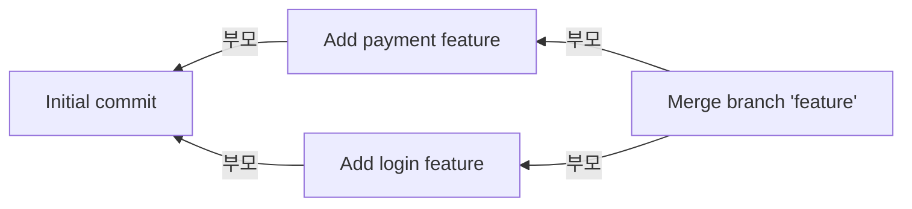

- 노드(점) = 커밋 4개
- 간선(선) = "내 부모는 저 커밋"이라는 연결 (화살표 끝이 부모, 오른쪽이 최신)
- 각 커밋이 저장한 부모

  | 커밋 | 부모 |
  |---|---|
  | `Initial commit` | 없음 |
  | `Add login feature` | `Initial commit` |
  | `Add payment feature` | `Initial commit` |
  | `Merge branch 'feature'` | `Add payment feature`, `Add login feature` |

#### DAG : 이 그래프가 DAG인 이유

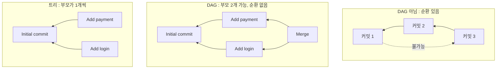

- **방향이 있음** : 커밋을 만들 때 앞 커밋은 이미 있지만 뒤 커밋은 아직 없음 → 앞 커밋만 기억 → 화살표는 항상 과거 방향
- **순환이 없음** : 이미 있는 커밋만 가리킬 수 있고, 만든 커밋은 바뀌지 않음 → 따라가면 결국 `Initial commit`에서 끝남 (오른쪽 그림처럼 과거 커밋이 미래 커밋을 가리키는 일은 불가능)
- **트리가 아님** : 트리는 부모가 하나뿐이어야 하는데, merge 커밋은 부모가 2개 (가운데 그림)

### 3-2. 해시맵 (`dict`)

- 정의 : 키(key)와 값(value) 쌍으로 이루어진 자료구조 (키를 해시 함수로 변환한 값으로 저장 위치를 정하므로, 키로 값을 평균 O(1)에 찾음)
- 요약 : 이름표(키)로 물건(값)을 바로 꺼내는 사물함
- 과제 요구 : 커밋 저장소는 커밋 hash로 빠르게 찾을 수 있어야 하고(해시맵 기반), hash는 세션 내에서 유일해야 함
- 구현 : `repository.py`
  - `commits = {hash: 커밋}` → hash로 커밋 바로 찾기
  - `branches = {브랜치 이름: hash}` → 브랜치가 가리키는 커밋
  - `_new_hash()` → 커밋 hash 생성

**그림 : hash로 커밋 찾기**

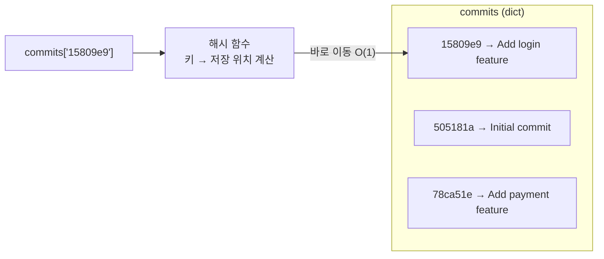

- hash 만들기 : 커밋 정보를 SHA-1 해시 함수에 넣고 앞 7자리 사용 (예: `505181a`)
- hash가 겹치지 않게
  - 커밋마다 1씩 늘어나는 번호를 함께 넣어 해싱 → 입력이 매번 다름
  - 그래도 이미 있는 hash가 나오면 다시 해싱 → 중복 0개 보장

### 3-3. 큐 (`deque`)

- 정의 : 먼저 넣은 데이터가 먼저 나오는 자료구조 (FIFO, First In First Out)
- 요약 : 먼저 줄 선 사람이 먼저 나가는 줄 서기
- 과제 요구 : 직접 요구는 없음 (BFS·위상 정렬 구현에 필요), 그래프 전용 라이브러리는 사용 금지
- 구현 : `graph.py`에서 표준 라이브러리 `collections.deque` 사용
  - BFS와 위상 정렬에서 "다음에 볼 커밋"을 세워 두는 줄

**그림 : 위상 정렬 1단계 직후의 큐 (뒤로 넣고 앞에서 꺼내기)**

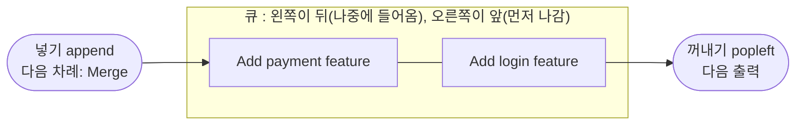

- `Initial commit`을 출력한 뒤 자식 2개가 순서대로 들어간 상태 ([4-1 단계별 진행](#4-1-위상-정렬--log) 표의 1단계)

- `list` 대신 쓴 이유 : 맨 앞에서 꺼낼 때 `list`는 O(N), `deque`는 O(1)

### 3-4. 집합 (`set`)

- 정의 : 중복을 허용하지 않는 원소들의 모음 (원소가 들어 있는지를 평균 O(1)에 확인)
- 요약 : 중복 없는 주머니
- 과제 요구 : 직접 요구는 없음 (`ANCESTORS`의 "빠짐없이" 출력과 역색인 중복 방지에 필요)
- 구현
  - `graph.py` : 조상 탐색에서 이미 본 커밋 기록 → 같은 커밋 두 번 출력 방지
  - `index.py` : 같은 커밋이 한 단어에 두 번 들어가지 않게 확인, 여러 단어 검색 시 교집합

**그림 : 방문 기록(visited)으로 중복 막기**

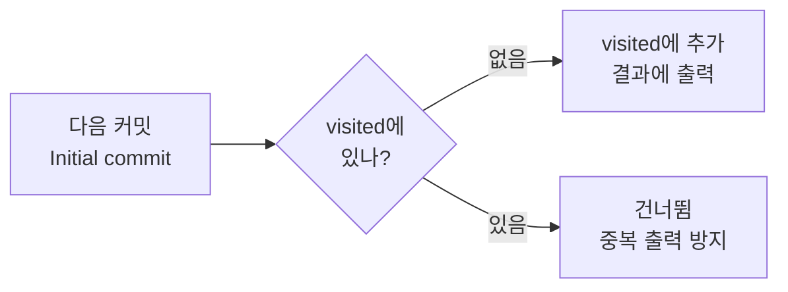

### 3-5. 역색인

- 정의 : "단어 → 그 단어가 들어 있는 문서 목록" 형태로 저장한 색인
- 요약 : 책 뒤의 "찾아보기"처럼 단어로 커밋을 바로 찾는 목록
- 과제 요구
  - 검색 시 모든 커밋을 순회하지 않고 후보를 빠르게 가져와야 함
  - 커밋 메시지를 공백으로 나누고 소문자로 바꾼 단어를 키워드로 저장
  - `keyword → commit_hash 목록`, `author → commit_hash 목록` 2종 지원
- 구현 : `index.py`
  - `InvertedIndex` : 키 → hash 목록을 저장하는 역색인 1개
  - `SearchIndex` : 키워드 인덱스 + 작성자 인덱스, `COMMIT` 할 때마다 갱신

**그림 : 단어 → 커밋 목록**


- 커밋할 때 : `"Add login feature"` → 공백으로 자르고 소문자로 → `add` / `login` / `feature`에 커밋 등록
- 검색할 때 : `login` 칸만 보면 바로 `15809e9` → 다른 커밋은 볼 필요 없음 (`commit` 같은 나머지 단어는 그림에서 생략)
- 왜 빠른가

  | 방법 | 검색할 때 하는 일 | 시간복잡도 |
  |---|---|---|
  | 전체 훑기 | 모든 커밋 메시지를 하나씩 확인 | O(N × 메시지 길이) |
  | 역색인 | `dict`에서 단어로 한 번 조회 | O(1) + 결과 수 |

- 규칙
  - 대소문자 무시 (`LOGIN` = `login`)
  - 단어 단위로 일치 → `log`로는 `login`을 찾지 않음 (메시지를 단어로 나눠 저장하기 때문)
  - 여러 단어(`"add login"`)는 모든 단어가 들어간 커밋만
  - 문장부호는 그대로 → `login,`과 `login`은 다른 단어 (과제 최소 기준)

---

## 4. 사용한 알고리즘

| 알고리즘 | 요약 | 쓰인 명령어 | 시간복잡도 |
|---|---|---|---|
| 위상 정렬 | 순서 조건을 지키며 줄 세우기 | `LOG` | O(V + E) |
| BFS 최단 경로 | 한 칸씩 넓혀 가며 찾기 | `PATH` | O(V + E) |
| BFS 조상 탐색 | 부모를 끝까지 따라가기 | `ANCESTORS` | O(V + E) |
| 병합 정렬 | 반씩 나눠 정렬한 뒤 합치기 | `LOG --sort-by` | O(N log N) |
| **[보너스]** 퀵·삽입 정렬 | 성능 비교용 정렬 | `BENCH` | O(N log N), O(N²) |
| **[보너스]** LCS | 두 목록에서 겹치는 가장 긴 부분 찾기 | `DIFF` | O(N × M) |
| **[보너스]** 병합 커밋 | 두 브랜치를 부모로 갖는 커밋 만들기 | `MERGE` | O(V + E) |

### 4-1. 위상 정렬 — `LOG`

- 정의 : 방향 그래프에서 "A가 B보다 먼저"라는 간선 조건을 모두 지키도록 노드를 일렬로 나열하는 것 (순환이 없는 DAG에서만 가능)
- 요약 : 순서 조건을 지키며 줄 세우기 (예: 선수과목을 먼저 듣도록 수강 순서 정하기)
- 과제 요구 : `LOG`는 최신순이 아니라 부모 커밋이 항상 자식 커밋보다 먼저 출력되어야 함
- 왜 위상 정렬인가
  - 최신순(시각 역순) → 자식이 먼저 나옴 → 요구와 반대
  - 만든 시각 순 → 같은 초에 만든 커밋끼리는 순서가 보장되지 않음
  - → 시각이 아니라 **부모 관계(그래프 구조)** 만 보고 순서를 정해야 항상 "부모 먼저"가 보장됨
- 구현 : `graph.py`의 `topological_sort()` (Kahn 알고리즘)
  1. 커밋마다 "아직 출력 안 된 부모 수"를 셈
  2. 그 수가 0인 커밋을 큐에 넣음
  3. 하나 꺼내 출력하고, 그 자식들의 수를 1씩 줄임
  4. 0이 된 자식을 큐에 넣음 → 큐가 빌 때까지 반복

**그림 : 출력 순서 (번호 = LOG에 나오는 순서)**

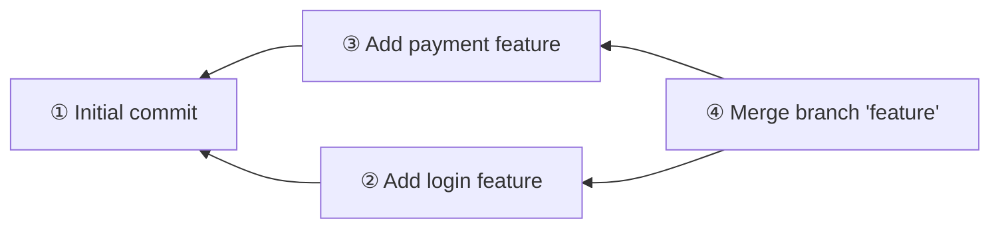

- 단계별 진행

  | 단계 | 출력 | 남은 부모 수 (바뀐 것만) | 큐 |
  |---|---|---|---|
  | 시작 | - | Initial 0, login 1, payment 1, Merge 2 | [Initial] |
  | 1 | Initial commit | login 0, payment 0 | [login, payment] |
  | 2 | Add login feature | Merge 1 | [payment] |
  | 3 | Add payment feature | Merge 0 | [Merge] |
  | 4 | Merge branch 'feature' | - | [] |

- 포인트
  - Merge는 부모 **둘 다** 출력된 뒤에야 큐에 들어감
  - 전부 출력하지 못하면 순환이 있다는 뜻 → 에러

### 4-2. BFS 최단 경로 — `PATH`

- 정의 : 시작 노드에서 가까운 노드부터 차례로 방문하는 그래프 탐색 방법 (Breadth-First Search, 너비 우선 탐색)
- 요약 : 한 칸씩 넓혀 가며 찾는 방법 (처음 도착한 경로 = 최단 경로)
- 과제 요구
  - 커밋-부모 연결을 방향 없는 선으로 보고, 지나가는 선이 가장 적은 경로
  - 경로가 없으면 `No path`
  - 최단 경로가 여러 개면 `hash1->hash2->...` 문자열이 사전순으로 가장 작은 경로
- 구현 : `graph.py`의 `shortest_path()`
  1. 도착점에서 BFS → 모든 커밋의 "도착점까지 남은 칸 수" 계산
  2. 출발점부터, 남은 칸 수가 1 줄어드는 이웃 중 **hash가 가장 작은 것**으로 이동

**그림 : `PATH 15809e9 78ca51e` (Add login → Add payment)**

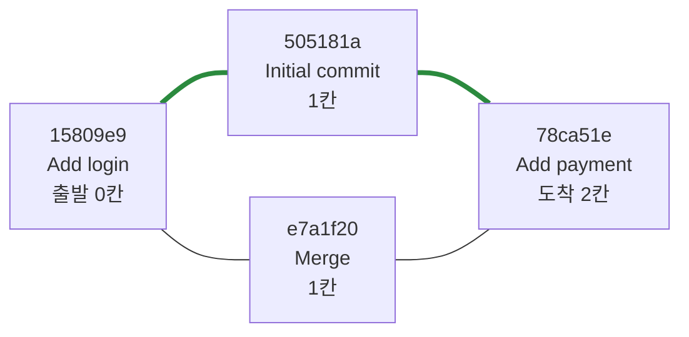

- 방향을 무시하므로 형제 커밋(`Add login`, `Add payment`)도 연결됨
- 최단 경로가 2개 (둘 다 2칸)
  - `15809e9 -> 505181a -> 78ca51e`
  - `15809e9 -> e7a1f20 -> 78ca51e`
- 경로의 두 번째 커밋을 고를 때 `505181a` < `e7a1f20` → 굵은 선 경로 선택
- 도착점에서 BFS를 하는 이유
  - 각 커밋이 "도착점까지 몇 칸 남았는지" 미리 알면, 출발점에서 한 칸씩 갈 때마다 "이 길로 가도 최단인지" 바로 판단 가능
  - 그래서 최단 경로 위에 있는 이웃들 중에서만 가장 작은 hash를 고르면 됨
- 매번 가장 작은 hash를 고르면 되는 이유
  - 문자열 비교는 앞글자부터 하고, hash는 모두 7자라 `->`가 항상 같은 위치에 옴
  - → 경로 문자열 비교 = 첫 번째 hash끼리, 다음 hash끼리 차례로 비교하는 것과 같음

### 4-3. BFS 조상 탐색 — `ANCESTORS`

- 정의 : 특정 커밋에서 부모 간선을 따라 도달할 수 있는 모든 커밋을 찾는 것
- 요약 : 부모 → 부모의 부모 → ... 끝까지 따라가 모두 모으기
- 과제 요구 : 해당 커밋에서 도달 가능한 모든 조상 커밋을 빠짐없이 출력
- 구현 : `graph.py`의 `find_ancestors()`
  - 부모 방향으로만 BFS
  - 이미 본 커밋은 `set`에 기록해 한 번만 출력

**그림 : `ANCESTORS` Merge (번호 = 찾은 순서)**

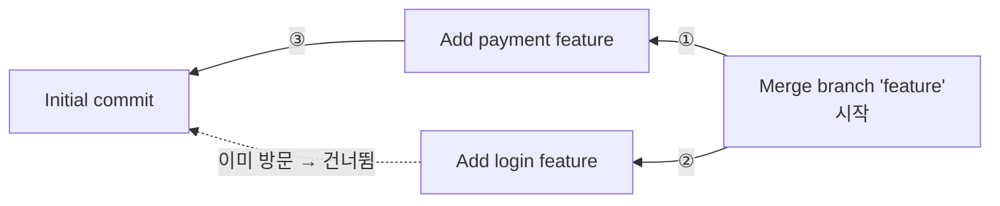

- 결과 : `Add payment feature`, `Add login feature`, `Initial commit` (3개, 중복 없음)
- `Initial commit`은 두 길로 도착하지만 두 번째는 `set`에 이미 있어서 건너뜀

### 4-4. 정렬 — `LOG --sort-by`

| 개념 | 정의 | 요약 |
|---|---|---|
| 정렬 | 데이터를 정해진 기준(key)에 따라 순서대로 나열하는 것 | 기준에 맞춰 줄 세우기 |
| 안정 정렬 | 기준값이 같은 데이터의 원래 순서를 유지하는 정렬 | 값이 같으면 원래 순서 그대로 |

- 과제 요구
  - `sorted()`, `list.sort()` 사용 금지 → 정렬 직접 구현
  - 비교 기준을 바꿔 정렬 가능 (`--sort-by=date`, `--sort-by=author`)
- 구현
  - `sorting.py`의 `merge_sort()` : 기준을 `key` 함수로 받음
  - `repository.py`의 `log()` : 날짜는 `timestamp`, 작성자는 `author`를 기준으로 전달

**그림 : 병합 정렬 (반씩 나누고 → 정렬하며 합치기)**

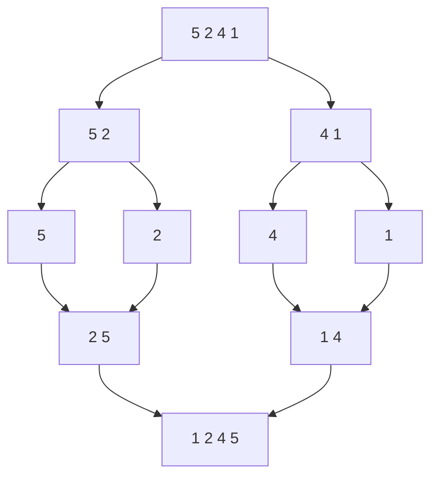

**그림 : 안정 정렬 (작성자 기준 정렬)**

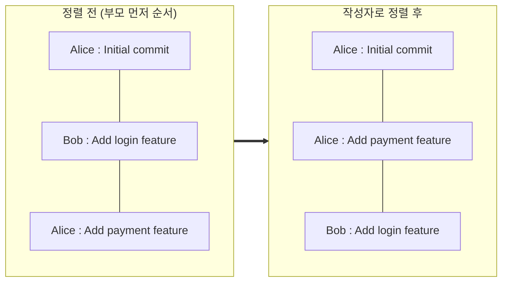

- 안정 정렬을 보여 주려고 `Add login feature`의 작성자만 Bob으로 가정
- Alice 커밋 2개는 정렬 후에도 원래 순서(`Initial commit` → `Add payment feature`) 그대로
- 병합 정렬의 시간복잡도와 안정성

  | 알고리즘 | 평균 | 최악 | 안정 정렬 |
  |---|---|---|---|
  | 병합 정렬 | O(N log N) | O(N log N) | O |

  - O(N log N)인 이유 : 반씩 나누면 log N 단계가 생기고, 단계마다 합치면서 N개를 한 번씩 비교
  - 입력이 어떻든 항상 반씩 나누므로 최악도 O(N log N)
  - 안정인 이유 : 합칠 때 값이 같으면 왼쪽(원래 앞에 있던) 원소를 먼저 넣음 (`<=` 비교)
- 병합 정렬을 고른 이유
  - 최악에도 O(N log N)
  - 안정 정렬이라 같은 작성자 안에서는 부모 먼저 순서가 유지됨

**[보너스] 정렬 알고리즘 성능 비교 — `BENCH`**

- 과제 요구 : 서로 다른 정렬 알고리즘을 2개 이상 구현하고, 입력 크기에 따른 실행 시간 비교
- 구현
  - `sorting.py` : `quick_sort()`, `insertion_sort()` 추가 구현
  - `benchmark.py` : 같은 난수 데이터로 세 정렬의 실행 시간(ms)을 크기별로 측정
- 세 정렬 비교

  | 알고리즘 | 동작 | 평균 | 최악 | 안정 정렬 |
  |---|---|---|---|---|
  | 병합 정렬 | 반씩 나눠 정렬한 뒤, 앞에서부터 비교하며 합침 | O(N log N) | O(N log N) | O |
  | 퀵 정렬 | 기준값보다 작은 것 / 큰 것으로 나눠 반복 | O(N log N) | O(N²) | X |
  | 삽입 정렬 | 카드 정리하듯 하나씩 알맞은 자리에 끼움 | O(N²) | O(N²) | O |

  - 퀵 정렬 최악 O(N²) : 기준값이 매번 가장 작거나 큰 값으로 뽑히면 한쪽으로만 나뉨
  - 퀵 정렬 안정성 X : 일반적인 퀵 정렬은 배열 안에서 원소를 맞바꾸며 같은 값의 순서가 섞이기 때문 (이 구현은 작은 값 / 같은 값 / 큰 값 리스트로 나누는 방식이라 실제로는 순서가 유지됨)

**그림 : 입력 크기별 실행 시간 (ms, `BENCH` 결과)**

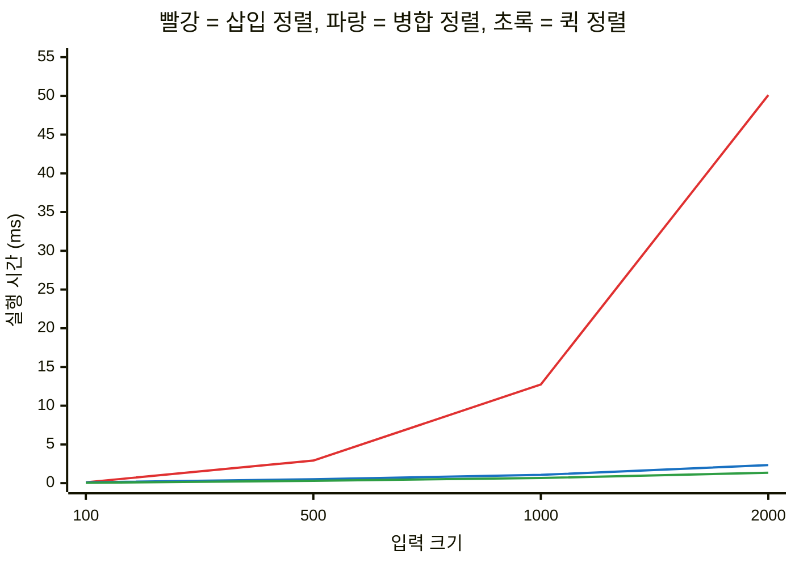

- 삽입 정렬만 크기가 2배가 될 때 약 4배씩 늘어남 → O(N²)

### 4-5. [보너스] LCS — `DIFF`

- 정의 : 두 수열에서 순서를 유지하며 공통으로 나타나는 가장 긴 부분 수열 (Longest Common Subsequence, 최장 공통 부분 수열)
- 요약 : 두 파일에서 순서를 지키며 겹치는 가장 긴 줄 목록
- 과제 요구 : `diff <file1> <file2>`로 두 텍스트 파일을 줄 단위로 비교하고, 추가/삭제/공통 줄을 구분해 출력
- 구현 : `diff.py`의 `diff_lines()`
  - 작은 구간의 답을 표에 저장해 두고 재사용하는 **동적 계획법**으로 LCS 계산
  - 겹치는 줄 = 공통(`  `), 첫 파일에만 있는 줄 = 삭제(`- `), 둘째 파일에만 있는 줄 = 추가(`+ `)

**그림 : `DIFF a.txt b.txt`**

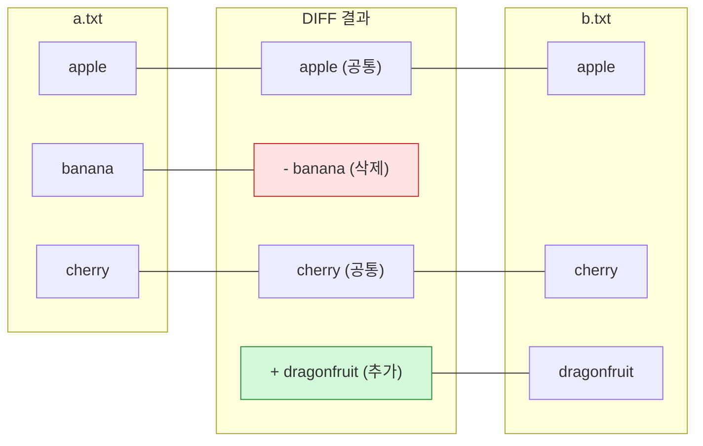

- LCS = `apple`, `cherry`
- 양쪽에 다 있는 줄은 공통, `a.txt`에만 있으면 삭제(빨강), `b.txt`에만 있으면 추가(초록)

### 4-6. [보너스] 병합 커밋 — `MERGE`

- 정의 : 두 브랜치의 작업을 하나로 합치면서, 두 브랜치의 마지막 커밋을 모두 부모로 갖는 커밋을 만드는 것
- 요약 : 부모가 2개인 커밋 만들기
- 과제 요구 : `merge <branch_name>`으로 현재 브랜치의 HEAD와 대상 브랜치의 HEAD를 부모로 하는 merge 커밋 생성
- 구현 : `repository.py`의 `merge()`
  - 대상 커밋이 이미 현재 커밋의 조상이면 합칠 내용이 없음 → `Already up to date.` (`graph.py`의 `is_ancestor()` 사용)
  - 아니면 `parents = [현재 커밋, 대상 커밋]`인 새 커밋 생성

**그림 : `main`에서 `MERGE feature` 실행 전 → 후**

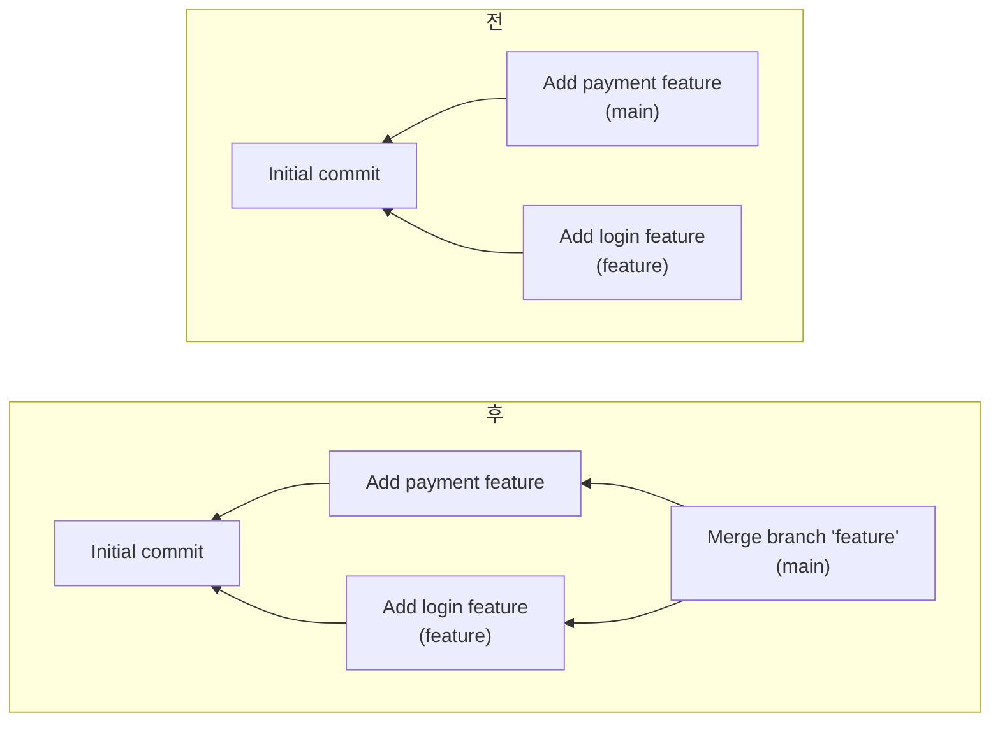

---

## 5. 실행 방법

```bash
python main.py
```

- Python 3.10 이상 필요, 외부 라이브러리 없음
- 3.10 미만이면 `Mini Git requires Python 3.10 or later.` 출력 후 종료 → `python3.11 main.py`처럼 버전 지정
- `mini-git>` 프롬프트에서 명령 입력, `exit` / `quit`으로 종료

---

## 6. 기능

### 입력 규칙

- 명령어 대소문자 구분 없음 (`INIT` = `init`)
- 공백이 있는 값은 따옴표로 감싸기: `commit "Add login feature"`
- 옵션 형식: `SEARCH --author=<name>`, `LOG --sort-by=date|author`

### 필수 기능

| 명령어 | 설명 |
|---|---|
| `INIT <user_name>` | 저장소 생성, `main` 브랜치·현재 사용자 설정 |
| `BRANCH <branch_name>` | 현재 커밋을 가리키는 새 브랜치 생성 |
| `SWITCH <branch_name>` | 다른 브랜치로 이동 |
| `COMMIT <message>` | 현재 커밋을 부모로 새 커밋 생성 |
| `LOG` | 전체 커밋 출력 (부모가 항상 먼저) |
| `LOG --sort-by=date` | 만든 시각 순 정렬 |
| `LOG --sort-by=author` | 작성자 이름 순 정렬 |
| `PATH <commit1> <commit2>` | 두 커밋 사이 최단 경로 |
| `ANCESTORS <commit_hash>` | 모든 조상 커밋 |
| `SEARCH <keyword>` | 메시지에 키워드가 들어간 커밋 |
| `SEARCH --author=<name>` | 해당 작성자의 커밋 |
| `EXIT` / `QUIT` | 종료 |

### [보너스] 기능

| 명령어 | 설명 |
|---|---|
| `MERGE <branch_name>` | 현재 브랜치 + 대상 브랜치를 부모로 하는 merge 커밋 생성 |
| `DIFF <file1> <file2>` | 두 텍스트 파일 줄 단위 비교 |
| `BENCH [크기 ...]` | 병합·퀵·삽입 정렬 실행 시간 비교 |

### 추가 기능

| 명령어 | 설명 |
|---|---|
| `BRANCH` (인자 없음) | 브랜치 목록 (`*` = 현재 브랜치) |
| `INIT <다른 이름>` 재실행 | 커밋 기록 유지, 사용자만 변경 |
| `HELP` | 명령어 목록 |

- `INIT` 재실행으로 사용자만 바꾸게 한 이유: 작성자가 여러 명이어야 작성자 검색·정렬을 확인할 수 있음

---

## 7. 시연

hash는 실행할 때마다 새로 만들어진다. (직접 실행하면 값이 다름)

### 7-1. 브랜치를 나눠서 커밋

```text
mini-git> init "Alice"
Initialized repository.
Current branch: main
Current user: Alice

mini-git> commit "Initial commit"
[main 505181a] Initial commit

mini-git> branch feature
Created branch: feature

mini-git> switch feature
Switched to branch: feature

mini-git> commit "Add login feature"
[feature 15809e9] Add login feature

mini-git> switch main
Switched to branch: main

mini-git> commit "Add payment feature"
[main 78ca51e] Add payment feature

mini-git> log
commit 505181a (Alice, 2026-10-11 03:56:11) [main]
Initial commit
commit 15809e9 (Alice, 2026-10-11 03:56:11) [feature]
Add login feature
commit 78ca51e (Alice, 2026-10-11 03:56:11) [main]
Add payment feature
```

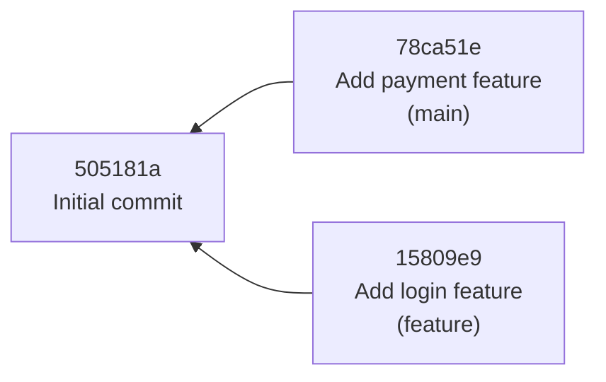

- 확인 포인트: 부모 `505181a`가 LOG에서 가장 먼저 출력

### 7-2. 경로, 조상, 검색

```text
mini-git> path 15809e9 78ca51e
Path: 15809e9 -> 505181a -> 78ca51e

mini-git> ancestors 78ca51e
Ancestors of 78ca51e (1):
- 505181a: Initial commit

mini-git> search "login"
Found 1 commit:
- 15809e9: Add login feature
```

- 확인 포인트: 형제 커밋끼리는 공통 부모 `505181a`를 거쳐 연결

### 7-3. 작성자 변경, 작성자 검색, 정렬

```text
mini-git> init "Bob"
Reinitialized repository (history kept).
Current branch: main
Current user: Bob

mini-git> commit "Fix login bug"
[main 043dbc1] Fix login bug

mini-git> search --author=bob
Found 1 commit:
- 043dbc1: Fix login bug

mini-git> search "LOGIN"
Found 2 commits:
- 15809e9: Add login feature
- 043dbc1: Fix login bug

mini-git> log --sort-by=author
commit 505181a (Alice, 2026-10-11 03:56:11)
Initial commit
commit 15809e9 (Alice, 2026-10-11 03:56:11)
Add login feature
commit 78ca51e (Alice, 2026-10-11 03:56:11)
Add payment feature
commit 043dbc1 (Bob, 2026-10-11 03:56:11)
Fix login bug
```

- 확인 포인트
  - `LOGIN`, `bob`처럼 대소문자가 달라도 검색됨
  - 작성자 정렬 후에도 Alice 커밋끼리는 원래 순서 유지 (안정 정렬)

### 7-4. [보너스] merge

```text
mini-git> merge feature
[main fbcf72e] Merge branch 'feature' into main

mini-git> log
commit 505181a (Alice, 2026-10-11 03:56:11) [main]
Initial commit
commit 15809e9 (Alice, 2026-10-11 03:56:11) [feature]
Add login feature
commit 78ca51e (Alice, 2026-10-11 03:56:11) [main]
Add payment feature
commit 043dbc1 (Bob, 2026-10-11 03:56:11) [main]
Fix login bug
commit fbcf72e (Bob, 2026-10-11 03:56:11) [main] Merge: 043dbc1 15809e9
Merge branch 'feature' into main

mini-git> path 15809e9 043dbc1
Path: 15809e9 -> fbcf72e -> 043dbc1

mini-git> ancestors fbcf72e
Ancestors of fbcf72e (4):
- 043dbc1: Fix login bug
- 15809e9: Add login feature
- 78ca51e: Add payment feature
- 505181a: Initial commit

mini-git> merge feature
Already up to date.
```

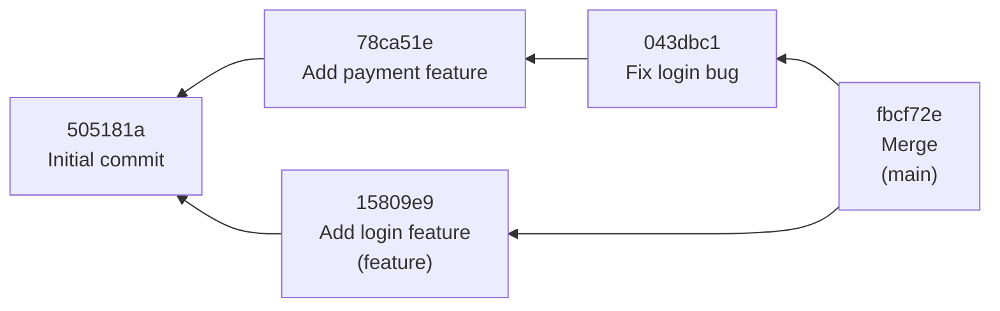

- 확인 포인트
  - merge 커밋은 부모 2개 → `Merge: 043dbc1 15809e9`
  - `15809e9 → 043dbc1` 경로: merge 전 3칸 → merge 후 2칸으로 짧아짐
  - `505181a`는 두 갈래 모두에서 도달하지만 조상 목록에 한 번만 출력
  - 이미 합친 브랜치는 `Already up to date.`

### 7-5. [보너스] diff, bench

```text
mini-git> diff a.txt b.txt
  apple
- banana
  cherry
+ dragonfruit
mini-git> bench
    size       merge       quick   insertion   (ms)
     100        0.10        0.05        0.11
     500        0.51        0.30        2.92
    1000        1.07        0.67       12.74
    2000        2.33        1.34       50.10
```

- 확인 포인트 (bench): 크기 2배일 때
  - 삽입 정렬: 약 4배 → O(N²)
  - 병합·퀵 정렬: 2배 조금 넘게 → O(N log N)

---

## 8. 프로젝트 구조

```text
Codyssey-B5-2-Mini-Git/
├── main.py                 # 실행 시작점 (Python 버전 확인 후 REPL 실행)
├── README.md
├── docs/
│   └── peer-review-qna.md  # 동료평가 예상 질문과 답변
├── minigit/
│   ├── commit.py           # 커밋 데이터 정의
│   ├── repository.py       # 저장소 상태 (커밋 dict, 브랜치, HEAD, 사용자, hash 생성, merge)
│   ├── graph.py            # 위상 정렬, 최단 경로, 조상 탐색
│   ├── sorting.py          # 병합 / 퀵 / 삽입 정렬
│   ├── index.py            # 역색인 (키워드, 작성자)
│   ├── cli.py              # 입력 해석, 명령 실행, 결과 출력
│   ├── diff.py             # (보너스) 줄 단위 비교
│   └── benchmark.py        # (보너스) 정렬 속도 비교
└── tests/
    └── test_minigit.py     # 단위 테스트
```

### 계층 구조

```text
cli.py                             입력 해석, 출력 문자열 생성
   ↓
repository.py                      브랜치·HEAD·커밋 관리, 잘못된 요청이면 에러
   ↓
graph.py / sorting.py / index.py   탐색·정렬·검색 알고리즘만 담당
```

- 알고리즘 파일은 출력·저장소 상태를 모름 → 데이터만 받아 결과 반환 → 따로 테스트 가능
- 출력 문구는 `cli.py`에서만 생성 → 출력 형식을 바꿔도 다른 파일은 그대로
- 명령어 → 처리 함수를 `dict`로 연결 → 새 명령어는 함수 1개 + `dict` 항목 1줄로 추가

### 과제에서 자유로 둔 부분의 결정

| 항목 | 결정 | 이유 |
|---|---|---|
| hash 형식 | SHA-1 앞 7자리 | 실제 Git 짧은 hash와 비슷, 길이가 같아야 경로 사전순 비교가 단순 |
| LOG 범위 | 모든 브랜치의 커밋 | 과제 예시 출력과 동일 |
| LOG의 `[main]` | 커밋을 만들 때의 브랜치 | 과제 예시 출력과 동일 |
| 날짜 정렬 동률 | 생성 순서 | 같은 초에 만든 커밋도 순서 결정 |
| 작성자 정렬 동률 | 원래 순서(부모 먼저) 유지 | 병합 정렬이 안정 정렬 |
| 커밋 전 BRANCH | 에러 | 가리킬 커밋이 없음 (실제 Git도 동일) |
| 따옴표 없는 공백 메시지 | `Invalid args` | 과제의 따옴표 규칙을 그대로 적용 |
| 이미 합친 브랜치 MERGE | `Already up to date.` | 대상이 이미 조상이면 합칠 내용 없음 |

---

## 9. 명령어 처리 흐름

### `commit "Add login"` 입력 시

```text
1. run()            input("mini-git> ")으로 한 줄 읽기 (exit / quit이면 종료)
2. execute()        try로 감싸서 에러가 나도 메시지만 출력하고 계속 진행
3. parse()          shlex.split으로 따옴표 묶어서 나누기 → ["commit", "Add login"]
                    명령어는 소문자로 변환 → 대소문자 구분 없음
4. handlers         "commit" → cmd_commit 찾기 (없으면 Unknown command)
5. cmd_commit()     인자가 정확히 1개인지 확인 (아니면 Invalid args)
6. Repository.commit()
     ├─ INIT 여부 확인
     ├─ 현재 브랜치가 가리키는 커밋을 부모로 지정 (첫 커밋이면 부모 없음)
     ├─ 겹치지 않는 7자리 hash 생성
     ├─ commits[hash]에 저장
     ├─ 현재 브랜치 이름표를 새 커밋으로 이동
     └─ 키워드 / 작성자 역색인에 등록
7. cmd_commit()     "[main 3fa91c2] Add login" 문자열 생성
8. run()            출력 후 다시 프롬프트
```

### LOG / SEARCH의 6번 단계

```text
LOG [--sort-by=date|author]
  ├─ graph.topological_sort()로 부모 먼저 순서 만들기
  ├─ date   → merge_sort(기준: 만든 시각, 같으면 생성 순서)
  └─ author → merge_sort(기준: 작성자 이름 소문자)

SEARCH <keyword>         → keyword_index 조회 (여러 단어면 교집합)
SEARCH --author=<name>   → author_index 조회
```

---

## 10. 예외 처리

- 잘못된 입력 → `MiniGitError` 발생 → `execute()`에서 잡아 메시지만 출력
- 어떤 입력이 와도 프로그램이 멈추지 않고 다음 입력을 받음

| 상황 | 입력 예 | 출력 |
|---|---|---|
| 인자가 없거나 너무 많음 | `commit` | `Invalid args` |
| 공백이 있는데 따옴표 없음 | `commit Add login` | `Invalid args` |
| 따옴표를 닫지 않음 | `commit "unclosed` | `Invalid args` |
| 잘못된 옵션 | `log --sort-by=size` | `Invalid args` |
| 없는 브랜치 | `switch nope` | `Unknown branch: nope` |
| 없는 커밋 | `ancestors zzz` | `Unknown commit: zzz` |
| 없는 명령어 | `hello` | `Unknown command: hello` |
| INIT 전에 다른 명령 | `log` | `Not initialized. Use INIT <user_name> first` |
| 이미 있는 브랜치 이름 | `branch main` | `Branch already exists: main` |
| 커밋이 하나도 없음 | `branch x`, `log` | `No commits yet` |
| 현재 브랜치를 자기 자신과 merge | `merge main` | `Cannot merge a branch into itself` |
| 없는 파일로 diff | `diff a.txt nope.txt` | `Cannot read file: nope.txt` |
| bench에 숫자가 아닌 값 | `bench abc` | `Invalid args` |
| 빈 줄 | (엔터) | 출력 없음 |
| Ctrl+D, Ctrl+C | | 정상 종료 |

---

## 11. 요구사항 체크리스트

### 최종 결과물

| 요구사항 | 확인 | README 위치 |
|---|---|---|
| `INIT`, `BRANCH`, `SWITCH`, `COMMIT` 결과 출력 (커밋은 hash 포함) | ✅ | [6. 기능](#6-기능), [7-1](#7-1-브랜치를-나눠서-커밋) |
| `LOG`, `PATH`, `ANCESTORS` (경로가 없으면 `No path`) | ✅ | [4-1](#4-1-위상-정렬--log) ~ [4-3](#4-3-bfs-조상-탐색--ancestors), [7-2](#7-2-경로-조상-검색) |
| `SEARCH <keyword>`, `SEARCH --author=<name>`, `LOG --sort-by=date\|author` | ✅ | [3-5](#3-5-역색인), [4-4](#4-4-정렬--log---sort-by), [7-3](#7-3-작성자-변경-작성자-검색-정렬) |
| `mini-git>` 프롬프트 반복 입력, `exit` / `quit`으로 종료 | ✅ | [5. 실행 방법](#5-실행-방법), [9. 처리 흐름](#9-명령어-처리-흐름) |
| `main.py` + `README.md`, `python main.py`로 실행 | ✅ | [5. 실행 방법](#5-실행-방법), [8. 구조](#8-프로젝트-구조) |

### 기능 요구사항

| 요구사항 | 확인 | README 위치 |
|---|---|---|
| 명령어 대소문자 구분 없음 | ✅ | [6. 입력 규칙](#입력-규칙), [9](#9-명령어-처리-흐름) |
| 공백이 들어간 값은 따옴표로 전달 | ✅ | [6. 입력 규칙](#입력-규칙), [9](#9-명령어-처리-흐름) |
| 옵션 표기 `--author=<name>`, `--sort-by=date\|author` | ✅ | [6. 입력 규칙](#입력-규칙) |
| 표준 에러 메시지 (`Invalid args`, `Unknown branch: <name>`, `Unknown commit: <hash>`) | ✅ | [10. 예외 처리](#10-예외-처리) |
| 커밋 필드 `hash`, `message`, `author`, `timestamp`, `parents` | ✅ | [2. 커밋](#커밋) |
| 부모 0개 이상, DAG 구조 | ✅ | [3-1](#3-1-그래프--dag) |
| hash로 빠르게 조회 (해시맵), 세션 안에서 hash 중복 없음 | ✅ | [3-2](#3-2-해시맵-dict) |
| 역색인 2종 (키워드, 작성자), 키워드는 공백 분리 + 소문자, 순회 없이 검색 | ✅ | [3-5](#3-5-역색인) |
| 정렬 직접 구현 (`sorted()`, `list.sort()` 미사용), 기준 변경 가능 | ✅ | [4-4](#4-4-정렬--log---sort-by) |
| `INIT` : main 브랜치 생성, HEAD 설정, 현재 사용자 설정 | ✅ | [2. 브랜치와 HEAD](#브랜치와-head), [6](#6-기능) |
| `BRANCH` / `SWITCH` : HEAD 커밋을 가리키는 브랜치 생성 / HEAD 이동 | ✅ | [2. 브랜치와 HEAD](#브랜치와-head) |
| `COMMIT` : HEAD를 부모로 새 커밋, 역색인 갱신 | ✅ | [3-5](#3-5-역색인), [9](#9-명령어-처리-흐름) |
| `LOG` : 부모가 항상 자식보다 먼저, hash / author / timestamp / message 표시 | ✅ | [4-1](#4-1-위상-정렬--log), [7-1](#7-1-브랜치를-나눠서-커밋) |
| `LOG --sort-by` 동률 처리 규칙 | ✅ | [8. 결정 사항](#과제에서-자유로-둔-부분의-결정) |
| `PATH` : 무방향 최단 경로, 여러 개면 사전순 최소, 없으면 `No path` | ✅ | [4-2](#4-2-bfs-최단-경로--path) |
| `ANCESTORS` : 모든 조상을 빠짐없이 | ✅ | [4-3](#4-3-bfs-조상-탐색--ancestors) |

### 제약 사항

| 요구사항 | 확인 | README 위치 |
|---|---|---|
| Python 3.10 이상 | ✅ | [5. 실행 방법](#5-실행-방법) |
| 그래프 전용 라이브러리 미사용 (큐로 표준 `collections.deque`만 사용) | ✅ | [3-3](#3-3-큐-deque) |
| 정렬 표준 API 미사용 (테스트로 소스 자동 검사) | ✅ | [4-4](#4-4-정렬--log---sort-by), [12](#12-테스트) |
| 탐색 / 정렬 / 인덱싱을 독립 파일로 분리 | ✅ | [8. 계층 구조](#계층-구조) |
| 주요 함수·클래스에 docstring | ✅ | 각 소스 파일 |
| 파일 내용 추적, 네트워크, 파일 저장 없음 | ✅ | [맨 위 소개](#mini-git) |

### 보너스

| 요구사항 | 확인 | README 위치 |
|---|---|---|
| `DIFF` 줄 단위 비교 (추가 / 삭제 / 공통) | ✅ | [4-5](#4-5-보너스-lcs--diff), [7-5](#7-5-보너스-diff-bench) |
| `MERGE` 부모 2개 merge 커밋 | ✅ | [4-6](#4-6-보너스-병합-커밋--merge), [7-4](#7-4-보너스-merge) |
| 정렬 알고리즘 2개 이상 구현 + 실행 시간 비교 (`BENCH`) | ✅ | [4-4](#4-4-정렬--log---sort-by), [7-5](#7-5-보너스-diff-bench) |

---

## 12. 테스트

```bash
python -m unittest discover tests -v
```

- 총 23개 테스트

| 분야 | 확인 내용 |
|---|---|
| 정렬 | 세 알고리즘 결과 일치, 기준 변경, 안정 정렬, 소스에 `sorted()` / `.sort()` 없음 |
| 그래프 | 부모 먼저 출력, 최단 경로 사전순, 형제 커밋 경로, `No path`, 조상 중복 없음, 순환 감지 |
| 역색인 | 대소문자 무시, 여러 단어 검색, 작성자 검색 |
| 저장소 | 커밋·브랜치 연결, 에러 처리, hash 2,000개 중복 없음, 정렬, merge |
| CLI | 따옴표 처리, 과제 예시 시나리오, 출력 형식, 에러 메시지 |
| 보너스 | diff 결과, 없는 파일 처리 |
