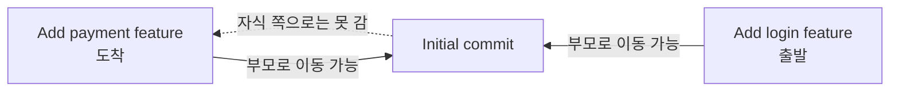
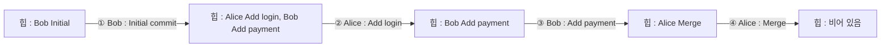

# 조건 변경 실험

- 지금 구현에서 규모나 규칙이 바뀌면 어디가 문제가 되고 무엇을 고치면 되는지 정리
- 설명 순서 : 달라지는 결과 → 바꿀 코드 → 같이 바꿀 테스트
- 2, 3번은 실제로 코드를 바꿔 돌려 보고 결과를 확인함

## 1. 커밋이 10배로 늘어나면

- 직접 잰 값 (커밋을 일직선으로 쌓고 측정, 실행마다 조금씩 다름)

  | 명령 | 시간복잡도 | 1,000개 | 10,000개 | 배수 |
  |---|---|---|---|---|
  | `LOG` | O(V + E) | 0.54ms | 5.57ms | 약 10배 |
  | `LOG --sort-by=author` | O(V log V) | 2.36ms | 27.89ms | 약 12배 |
  | `PATH` (처음 ↔ 끝) | O(V + E) | 0.73ms | 7.62ms | 약 10배 |
  | `ANCESTORS` | O(V + E) | 0.24ms | 2.37ms | 약 10배 |
  | `SEARCH` | O(결과 수) | 0.04ms | 0.44ms | 결과도 10배라 10배 |

- 병목과 개선 방향

  | 병목 | 개선 방향 |
  |---|---|
  | 호출할 때마다 `build_children()`, `_undirected_neighbors()`를 처음부터 다시 만듦 | 커밋할 때 부모 → 자식 표, 이웃 표에 한 줄씩 추가해 두고 계속 사용 (증분 갱신) |
  | `LOG`마다 위상 정렬 | 부모는 항상 자식보다 먼저 만들어짐 → **만든 순서 자체가 위상 정렬 순서** → `commits`를 넣은 순서대로 읽으면 O(V) |
  | `LOG --sort-by`마다 전체 정렬 | 정렬 결과를 저장해 두고 새 커밋만 이진 탐색으로 끼워 넣기 (date 기준은 새 커밋이 항상 맨 뒤) |
  | `MERGE`의 `is_ancestor()`가 조상을 끝까지 다 찾은 뒤 비교 | BFS 도중 대상을 만나면 바로 멈추기 |
  | 여러 단어 `SEARCH`의 교집합 | 가장 짧은 후보 목록부터 시작 |
  | hash 7자리 = 약 2억 6,800만 가지 | 커밋 약 19,000개면 한 번이라도 겹칠 확률 50% (생일 문제), 재해싱으로 오류는 없지만 더 커지면 자릿수 늘리기 |

## 2. `PATH`를 부모 방향만 허용하면

- 달라지는 결과 : "자손 → 조상" 관계일 때만 경로가 생김

  | PATH | 지금 (무방향) | 부모 방향만 |
  |---|---|---|
  | `Add login` → `Add payment` (형제) | `15809e9 -> 505181a -> 78ca51e` | `No path` |
  | `Merge` → `Initial commit` (자손 → 조상) | `e7a1f20 -> 15809e9 -> 505181a` | 같음 |
  | `Initial commit` → `Merge` (조상 → 자손) | `505181a -> 15809e9 -> e7a1f20` | `No path` |

  - `PATH A B`와 `PATH B A`의 결과가 달라짐
  - 경로가 있어도 무방향일 때와 길이가 같거나 더 김 (갈 수 있는 길이 줄었으니까)

**그림 : 부모 방향만 허용할 때 (화살표 방향으로만 이동)**

예시 상황 : `Add login feature`에서 `Add payment feature`로 가려는 경우



- 바꿀 코드 : `graph.py`의 `shortest_path()`
  - 1단계 : 도착점에서 "남은 칸 수"를 구하는 BFS를 무방향 이웃이 아니라 `build_children()`(자식 방향)으로 돌림 (출발점은 도착점의 자손이어야 하므로 도착점에서 자식 쪽으로 퍼짐)
  - 2단계 : 출발점에서 다음 커밋을 이웃 전체가 아니라 `graph[current].parents`에서만 고름

  ```python
  dist_to_end = _bfs_distances(build_children(graph), end)  # 도착점에서 자식 방향으로 남은 칸 수 계산
  ...
  for nxt in graph[current].parents:  # 이웃 전체가 아니라 부모만 후보로
  ```

- 같이 바꿀 것 : `test_shortest_path_undirected`의 기대값을 `None`으로, `HELP`와 README의 `PATH` 설명

## 3. 작성자 정렬에서 "부모 먼저"도 지켜야 하면

| 개념 | 정의 | 요약 |
|---|---|---|
| 우선순위 큐 | 넣은 순서가 아니라 우선순위가 가장 높은 원소부터 꺼내는 자료구조 | 줄 서기 대신 "가장 급한 사람부터" |
| 최소 힙 | 부모 칸 값이 항상 자식 칸 값보다 작거나 같은 완전 이진 트리 (배열로 구현, 넣기·꺼내기 O(log N)) | 가장 작은 값이 항상 맨 위에 있는 우선순위 큐 |

- 지금 방식의 문제 : 위상 정렬 → 작성자로 병합 정렬 → 정렬하면서 부모 먼저 순서가 깨질 수 있음
  - 예시 : `Initial commit`, `Add payment`는 Bob, `Add login`, `Merge`는 Alice

  | 순서 | 지금 방식 (작성자로 정렬) | 바꾼 방식 (우선순위 위상 정렬) |
  |---|---|---|
  | 1 | Alice : Add login ✗ (부모 Initial보다 먼저) | Bob : Initial commit |
  | 2 | Alice : Merge ✗ (부모 Add payment보다 먼저) | Alice : Add login |
  | 3 | Bob : Initial commit | Bob : Add payment |
  | 4 | Bob : Add payment | Alice : Merge |

- 해결 : Kahn 알고리즘의 큐(`deque`)를 최소 힙으로 바꿈
  1. 커밋마다 "아직 출력 안 된 부모 수"를 셈 (지금과 같음)
  2. 그 수가 0인 커밋을 최소 힙에 넣음 (기준 = `(작성자 소문자, 생성 순번)`)
  3. 힙에서 꺼내면 "지금 출력할 수 있는 커밋 중 작성자가 가장 앞인 커밋"이 나옴
  4. 그 자식들의 수를 1씩 줄이고 0이 된 자식을 힙에 넣음 → 반복

**그림 : 우선순위 위상 정렬 진행 (번호 = 출력 순서)**

예시 상황 : 위 표의 커밋 4개를 작성자 기준 + 부모 먼저로 출력하는 경우



- "부모 먼저"가 1순위, 작성자순은 2순위 → 완벽한 작성자순이 아닐 수 있음 (이 요구에서 가능한 최선)
- 시간복잡도 : O((V + E) log V) (힙에 넣고 꺼낼 때마다 log V)
- 정렬 표준 API 금지 조건이 있으므로 `heapq` 대신 힙을 직접 구현 (`sorting.py`처럼)

## 4. hash 생성 방식을 바꾸면

- 지금 방식 : `SHA-1(번호 | nonce | 메시지 | 작성자 | 시각)`의 앞 7자리
  - 시각이 들어가서 실행할 때마다 hash가 달라짐 → 테스트는 이미 hash가 바뀌는 상황을 대비해 둠
  - `test_path_and_ancestors_output` : hash를 미리 적지 않고 출력에서 잘라 씀
  - `test_merge` : `PATH` 동률일 때 hash 크기에 따라 답이 바뀌어서 `smaller_path()`로 기대값을 계산

| | 카운터 기반 (시각 제외) | 난수 기반 |
|---|---|---|
| 테스트 | hash를 고정값으로 비교 가능 | 고정값 비교 불가, 출력에서 꺼내 쓰거나 형식(7자리 16진수)만 검사 |
| 재현성 | 같은 명령 순서 → 같은 hash → 같은 `PATH` 동률 결과 | 실행마다 `PATH` 동률 결과가 바뀔 수 있음, `random.Random(seed)`로 seed를 고정해야 재현 |
| 디버깅 | 버그 보고에 적힌 hash를 그대로 다시 만들 수 있음 | 보고된 hash를 다시 만들 수 없어서 입력한 명령 기록이 따로 필요 |
| 충돌 | 앞 7자리만 쓰면 여전히 겹칠 수 있음 → 재해싱 유지 | 같음 → 재해싱 유지 |

- `PATH` 동률 처리가 hash 사전순이라, hash 방식이 바뀌면 같은 그래프에서도 경로 결과가 달라질 수 있음 → 재현성이 가장 크게 영향받는 부분
