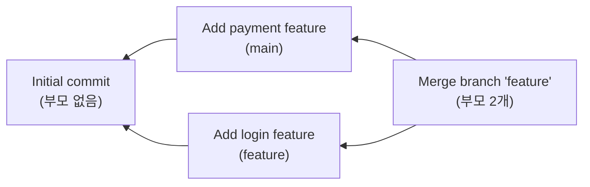

# B5-2 Mini Git 동료평가 대비 문서

> 평가자와 피평가자(나), 두 사람의 대화 형식으로 정리했습니다.
> 평가 때 나올 만한 질문과 답변, 그리고 직접 보여 줄 코드 위치를 함께 적었습니다.

## 목차

1. [과제 소개](#1-과제-소개)
2. [핵심 개념 확인](#2-핵심-개념-확인)
3. [최종 결과물 요구사항](#3-최종-결과물-요구사항)
4. [프로젝트 구조와 설계](#4-프로젝트-구조와-설계)
5. [기능 시연](#5-기능-시연)
6. [명령어 처리 흐름](#6-명령어-처리-흐름)
7. [예외 처리](#7-예외-처리)
8. [제약 사항 확인](#8-제약-사항-확인)
9. [꼬리 질문 대비](#9-꼬리-질문-대비)
10. [조건이 바뀐다면](#10-조건이-바뀐다면)

---

## 1. 과제 소개

**평가자**: 먼저 어떤 과제인지 소개해 주세요.

**나**: "파일이 언제 어떻게 바뀌었는지 기록하는 작은 프로그램 만들기", B5-2 과제입니다.
Git의 핵심 구조를 직접 구현한 CLI 기반 Mini Git을 만들었습니다.
파일 내용은 추적하지 않고 커밋의 **메타데이터**(hash, 메시지, 작성자, 시각, 부모)만 다룹니다.
데이터는 메모리에만 저장되고, 프로그램을 끄면 사라집니다.

**평가자**: 이 과제로 무엇을 배우는 건가요?

**나**: 다섯 가지입니다.

1. 커밋 그래프를 구현하면서 Git의 커밋 구조가 왜 **DAG**인지
2. 부모가 먼저 출력되는 로그를 만들기 위한 **위상 정렬**
3. 두 커밋 사이 **최단 경로(BFS)** 와 **조상 탐색**
4. **정렬 알고리즘**을 직접 구현하고 시간복잡도와 안정성 설명하기
5. **역색인**이 순회 검색보다 빠른 이유

**평가자**: 실행은 어떻게 하나요?

**나**: `python main.py`입니다. Python 3.10 이상이 필요합니다.
3.10 미만이면 `Mini Git requires Python 3.10 or later.`를 출력하고 종료하도록 [main.py](../main.py)에서 먼저 버전을 확인합니다.
`str | None` 같은 타입 표기가 3.10부터 지원되기 때문입니다.

---

## 2. 핵심 개념 확인

### DAG

**평가자**: DAG가 뭐예요? Git의 커밋 구조는 왜 DAG인가요?

**나**: 화살표에 방향이 있고, 따라가도 제자리로 돌아오지 않는 그래프예요.
커밋은 "내 바로 앞 커밋"을 기억하니까 화살표가 항상 과거로만 향하고, 따라가면 결국 첫 커밋에서 끝나요.
그리고 merge 커밋은 바로 앞 커밋이 두 개라서 트리가 아니라 DAG예요.

**평가자**: 화살표가 왜 과거를 향해요?

**나**: 커밋을 만들 때 앞 커밋은 이미 있지만 뒤 커밋은 아직 없어서, 앞 커밋만 기억할 수 있어요.

**평가자**: 왜 제자리로 돌아오지 않죠?

**나**: 이미 있는 커밋만 부모로 가리킬 수 있고, 한번 만든 커밋은 바뀌지 않아서요.

**평가자**: 트리랑은 뭐가 달라요?

**나**: 트리는 바로 앞이 하나뿐이어야 하는데, merge 커밋은 두 개예요. 그림으로 보면 이렇습니다.

**예시 상황**: 최초 커밋 이후 `main`에서는 결제 기능, `feature` 브랜치에서는 로그인 기능을 각각 개발한 뒤, 두 브랜치를 하나로 합친(merge) 경우



**평가자**: 코드에서 사이클이 없다는 걸 확인하는 부분이 있나요?

**나**: 구조상 생길 수 없지만, [graph.py](../minigit/graph.py)의 `topological_sort`에서 한 번 더 검사합니다.
위상 정렬 결과 개수가 전체 커밋 수보다 적으면 사이클이 있다는 뜻이라 `ValueError`를 발생시킵니다.
테스트에서 일부러 사이클 그래프를 만들어 이 에러가 나는지 확인했습니다.

**평가자**: 사이클이 생기면 실제로 뭐가 문제예요?

**나**: 두 가지가 깨집니다.

- **LOG** : A가 B의 부모이면서 B가 A의 부모면 "부모 먼저" 순서 자체가 없어요. 위상 정렬에서 처음 꺼낼 커밋(남은 부모 수 0)이 없어서 하나도 출력 못 합니다.
- **ANCESTORS** : 방문 기록이 없으면 같은 커밋을 계속 돌아서 안 끝나요. 방문 기록이 있어도 "내가 내 조상"이라는 말이 안 되는 결과가 나옵니다.

결국 "이 변경이 저 변경보다 먼저"라는 기록의 순서가 사라집니다.

### 위상 정렬

**평가자**: LOG는 최신순이 아니라 "부모가 먼저" 출력되어야 하는데, 어떻게 구현했나요?

**나**: **Kahn 알고리즘**으로 위상 정렬을 했습니다.

1. 각 커밋의 **진입 차수**를 "아직 출력되지 않은 부모 수", 즉 처음엔 `len(parents)`로 둡니다.
2. 진입 차수가 0인 커밋(최초 커밋)을 큐에 넣습니다.
3. 큐에서 하나 꺼내 출력하고, 그 커밋의 **자식들**의 진입 차수를 1씩 줄입니다.
4. 진입 차수가 0이 된 자식은 "모든 부모가 출력되었다"는 뜻이므로 큐에 넣습니다.
5. 큐가 빌 때까지 반복합니다.

커밋은 부모만 알고 자식은 모르기 때문에, 먼저 `build_children`으로 `parents`를 뒤집은 "부모 → 자식" 맵을 만듭니다.
시간복잡도는 각 노드와 간선을 한 번씩 보므로 **O(V + E)** 입니다.

**평가자**: 그냥 커밋을 만든 순서대로 출력해도 부모가 먼저 나오지 않나요?

**나**: 이 프로그램에서는 부모가 항상 먼저 만들어지니 결과가 같을 수 있습니다.
하지만 생성 순서는 "우연히" 맞는 것이고, 그래프 구조만 보고 순서를 보장하는 게 과제 목표입니다.
위상 정렬은 그래프 자체에서 순서를 계산하기 때문에 커밋이 어떤 순서로 저장되어 있든 항상 부모가 먼저 나옵니다.

**평가자**: DFS로 부모부터 출력하면 안 되나요?

**나**: 부모가 여럿인 merge 커밋에서 문제가 됩니다. 한쪽 부모를 따라 내려가다가 merge 커밋을 출력하면,
아직 출력되지 않은 다른 부모보다 먼저 나올 수 있습니다.
진입 차수를 세면 **모든 부모가 출력된 뒤에만** 자식이 큐에 들어가서 이 문제가 없습니다.

### 최단 경로 (PATH)

**평가자**: PATH는 어떻게 최단 경로를 찾나요?

**나**: 과제 정의대로 커밋-부모 연결을 **무방향 간선**으로 보고 **BFS**를 합니다.
무방향이라 형제 커밋끼리도 공통 부모를 거쳐 연결됩니다. 예를 들어 `Add login feature`와 `Add payment feature` 사이 경로는 `Initial commit`을 거칩니다.

**평가자**: 왜 BFS가 최단 경로를 보장하나요?

**나**: 모든 간선의 가중치가 1이기 때문입니다. BFS는 거리 1인 노드를 모두 방문한 다음에 거리 2인 노드를 방문합니다.
그래서 어떤 노드에 **처음 도달했을 때의 거리가 곧 최단 거리**입니다.
DFS는 깊이 먼저 들어가므로 처음 찾은 경로가 최단이라는 보장이 없습니다.

**평가자**: 최단 경로가 여러 개면 사전순으로 가장 작은 경로를 골라야 하죠. 어떻게 처리했나요?

**나**: 두 단계입니다.

1. **도착점에서** BFS를 돌려서 모든 커밋의 "도착점까지 남은 거리"를 구합니다.
2. 출발점에서 시작해 매 단계 **남은 거리가 정확히 1 줄어드는 이웃** 중 **hash가 가장 작은 것**을 고릅니다.

남은 거리가 1씩 줄어드는 이웃만 따라가니 항상 최단 경로 위에 있습니다.
그리고 hash 길이가 모두 7자로 같아서, `h1->h2->...` 문자열의 사전순 비교는 첫 hash끼리, 그다음 hash끼리 차례로 비교하는 것과 같습니다.
그래서 매 단계 가장 작은 hash를 고르면 전체 경로도 사전순으로 가장 작습니다.

**평가자**: hash 길이가 다르면요?

**나**: 그러면 `"ab->..."`와 `"abc->..."`처럼 구분자 `->`의 위치가 어긋나서 이 그리디가 틀릴 수 있습니다.
그래서 hash를 **고정 길이 7자**로 설계했습니다.

**평가자**: 경로가 없으면요?

**나**: 도착점에서 BFS를 했는데 출발점까지 도달하지 못하면 `None`을 반환하고, CLI에서 `No path`를 출력합니다.
CLI로 만드는 커밋은 모두 첫 커밋에서 이어지므로 실제로는 연결되어 있습니다. 대신 테스트에서 루트가 2개인 그래프를 직접 만들어 확인했습니다. `demo.py` 4번 장면에서도 같은 함수로 `No path`를 보여 줍니다.

### 조상 탐색 (ANCESTORS)

**평가자**: ANCESTORS는요?

**나**: 시작 커밋에서 `parents` 방향으로만 BFS를 합니다.
`visited` 집합으로 이미 넣은 커밋은 다시 넣지 않으니, merge 때문에 같은 조상에 여러 경로로 도달해도 **빠짐없이, 중복 없이** 한 번씩만 출력됩니다.
가까운 조상부터 나오고 자기 자신은 제외합니다. 시간복잡도는 **O(V + E)** 입니다.

### 정렬 알고리즘

**평가자**: `sorted()`, `list.sort()`를 쓰지 않았는지 어떻게 확인하나요?

**나**: 테스트 `test_no_builtin_sort_used`가 `minigit/` 폴더의 모든 소스를 읽어서 `sorted(`나 `.sort(`가 있으면 실패합니다.
직접 `grep -rnE '\bsorted\(|\.sort\(' minigit main.py`로 확인해도 아무것도 나오지 않습니다.

**평가자**: 어떤 정렬을 구현했고, 시간복잡도와 안정성은요?

**나**: [sorting.py](../minigit/sorting.py)에 세 가지를 구현했습니다.

| 알고리즘 | 평균 | 최악 | 안정 정렬 |
|---|---|---|---|
| 병합 정렬 | O(N log N) | O(N log N) | O |
| 퀵 정렬 | O(N log N) | O(N²) | X |
| 삽입 정렬 | O(N²) | O(N²) | O |

- **병합 정렬**: 반으로 나눠 각각 재귀적으로 정렬한 뒤, 두 정렬된 리스트를 앞에서부터 비교하며 합칩니다. 나누는 단계가 log N번, 각 단계에서 합치는 비용이 N이라 O(N log N)입니다.
- **퀵 정렬**: 피벗보다 작은 것, 같은 것, 큰 것으로 나눠 재귀합니다. 피벗이 매번 최솟값이나 최댓값으로 뽑히면 한쪽으로만 쪼개져서 O(N²)이 됩니다.
- **삽입 정렬**: 앞쪽의 정렬된 부분에 원소를 하나씩 알맞은 자리에 끼워 넣습니다. 거의 정렬된 입력에서는 O(N)으로 빠릅니다.

**평가자**: 안정 정렬이 뭔가요?

**나**: 기준값이 같은 원소들의 **원래 순서가 정렬 후에도 유지**되는 정렬입니다.
병합 정렬은 합칠 때 `key(left[i]) <= key(right[j])`, 즉 값이 같으면 **왼쪽 원소를 먼저** 넣기 때문에 안정적입니다.
`<`로 바꾸면 같은 값일 때 오른쪽이 먼저 들어가서 안정성이 깨집니다.

**평가자**: LOG 정렬에 왜 병합 정렬을 골랐나요?

**나**: 두 가지 이유입니다.

1. 최악의 경우에도 O(N log N)입니다.
2. 안정 정렬이라 `--sort-by=author`에서 같은 작성자의 커밋이 **위상 정렬 순서(부모 먼저)를 그대로 유지**합니다.
   입력을 위상 정렬 순서로 넣고 작성자로 안정 정렬하니, 동률 처리를 따로 만들 필요가 없습니다.

**평가자**: 비교 기준은 어떻게 바꾸나요?

**나**: 모든 정렬 함수가 `key` 함수를 받습니다.

```python
merge_sort(commits, key=lambda c: (c.timestamp, c.seq))   # 날짜, 같으면 생성 순번
merge_sort(commits, key=lambda c: c.author.lower())       # 작성자 이름(대소문자 무시)
```

`--sort-by=date`에서 `seq`를 같이 쓰는 이유는, 같은 초에 만든 커밋도 생성 순서대로 정렬되게 하기 위해서입니다.

### 역색인

**평가자**: 역색인이 뭔가요?

**나**: 책 뒤의 "찾아보기"와 같습니다. 문서 → 단어가 아니라 **단어 → 문서 목록**으로 저장합니다.
[index.py](../minigit/index.py)에 두 개의 인덱스가 있습니다.

```text
"Add login feature" → split + lower → ["add", "login", "feature"]

keyword_index = { "add": [A, B], "login": [B, D], "feature": [B], ... }
author_index  = { "alice": [A, B, C], "bob": [D] }
```

**평가자**: 순회 검색보다 왜 빠른가요?

**나**:

- **순회 검색**: 검색할 때마다 커밋 N개의 메시지(길이 L)를 모두 확인해야 하니 **O(N × L)** 입니다.
- **역색인**: 커밋할 때 미리 단어별로 기록해 두고, 검색할 때는 딕셔너리 조회 한 번(평균 **O(1)**)으로 후보 목록을 바로 가져옵니다. 결과 K개를 출력하는 비용까지 합치면 **O(K)** 입니다.

커밋할 때 토큰 수만큼 일을 미리 해 두는 대신, 검색 속도가 커밋 개수와 상관없어집니다.

**평가자**: 키워드는 어떤 기준으로 뽑나요?

**나**: 과제 최소 기준대로 메시지를 **공백으로 split한 뒤 lower**로 소문자화한 토큰입니다.
그래서 `search "LOGIN"`도 `login`을 찾습니다.
다만 문장부호는 제거하지 않아서 `"login,"`과 `"login"`은 다른 토큰입니다. 이건 과제 기준을 그대로 따른 한계입니다.

**평가자**: 검색어가 여러 단어면요?

**나**: `search "add login"`처럼 여러 단어면 각 단어의 후보 목록을 **교집합**합니다(AND 검색).
첫 단어의 목록에서 출발해 나머지 단어의 목록을 `set`으로 만들어 걸러 내므로 생성 순서가 유지됩니다.

**평가자**: 같은 커밋이 한 키에 두 번 들어가는 일은 없나요?

**나**: `"login login"`처럼 같은 단어가 두 번 나와도, `InvertedIndex`가 키마다 `set`을 따로 두고 이미 있는 hash는 추가하지 않습니다.
목록(`list`)은 순서 유지용이고, 집합(`set`)은 O(1) 중복 확인용입니다.

---

## 3. 최종 결과물 요구사항

**평가자**: 최종 결과물 요구사항을 하나씩 확인해 볼게요.

**나**: 과제의 최종 결과물 항목과 구현 위치를 표로 정리했습니다.

| 요구사항 | 명령어 | 구현 위치 |
|---|---|---|
| 저장소 및 브랜치 관리 | `INIT`, `BRANCH`, `SWITCH`, `COMMIT` | `repository.py` (`init`, `create_branch`, `switch`, `commit`) |
| 커밋 로그 및 탐색 | `LOG`, `PATH`, `ANCESTORS` | `graph.py` (`topological_sort`, `shortest_path`, `find_ancestors`) |
| 검색 및 정렬 | `SEARCH`, `SEARCH --author=`, `LOG --sort-by=` | `index.py`, `sorting.py` |
| CLI(REPL) | `mini-git>` 프롬프트, `exit`/`quit` | `cli.py` (`run`, `MiniGitCLI.execute`) |
| 필수 제출물 | `main.py` + `README.md` | 루트 |

**평가자**: 커밋 노드의 필수 필드는요?

**나**: [commit.py](../minigit/commit.py)의 `Commit` 데이터클래스에 `hash`, `message`, `author`, `timestamp`, `parents`가 있습니다.
여기에 두 개를 추가했습니다.

- `branch`: 커밋을 만든 브랜치 이름. 과제 예시처럼 LOG에 `[main]`을 표시하는 데 씁니다.
- `seq`: 생성 순번. 같은 초에 만든 커밋의 순서를 구분합니다.

**평가자**: 커밋 저장소는 hash로 빠르게 찾을 수 있나요?

**나**: `Repository.commits`가 `dict[str, Commit]` 해시맵이라 hash로 평균 O(1)에 찾습니다.

**평가자**: hash가 세션 안에서 유일하다는 건 어떻게 보장하나요?

**나**: [repository.py](../minigit/repository.py)의 `_new_hash`입니다.

1. `카운터 | nonce | 메시지 | 작성자 | 시각`을 SHA-1로 해싱하고 앞 7자리를 씁니다.
2. 카운터가 커밋마다 1씩 증가하므로 해싱 입력이 매번 다릅니다.
3. 그래도 7자리로 자르면 아주 드물게 결과가 겹칠 수 있어서, 이미 `commits`에 있는 hash면 `nonce`를 올려 다시 해싱합니다.

마지막 확인이 있어서 중복은 절대 생기지 않습니다. 테스트에서 같은 메시지로 2,000개를 만들어 중복 0개를 확인했습니다.

---

## 4. 프로젝트 구조와 설계

**평가자**: 프로젝트 구조를 설명해 주세요.

**나**:

```text
Codyssey-B5-2-Mini-Git/
├── main.py                 # 엔트리 포인트 (버전 확인 후 REPL 실행)
├── demo.py                 # 시연 자동화 (모든 기능 + 테스트 출력)
├── README.md
├── docs/
│   ├── peer-review-qna.md  # 이 문서
│   ├── visualization.html  # 브라우저용 실행 화면 + 단계별 그림
│   └── evaluation-guide.html  # 질문별 정리 + 연습 모드
├── minigit/
│   ├── commit.py           # Commit 노드
│   ├── repository.py       # 저장소 상태 (커밋 해시맵, 브랜치, HEAD, 사용자)
│   ├── graph.py            # 위상 정렬, 최단 경로, 조상 탐색
│   ├── sorting.py          # 병합 / 퀵 / 삽입 정렬
│   ├── index.py            # 역색인
│   ├── cli.py              # REPL: 파싱 → 실행 → 출력
│   ├── diff.py             # (보너스) 줄 단위 diff
│   └── benchmark.py        # (보너스) 정렬 성능 비교
└── tests/
    └── test_minigit.py     # 단위 테스트 23개
```

**평가자**: 왜 이렇게 나눴나요?

**나**: 3개 층으로 나눴습니다.

```text
cli.py  (입력 파싱, 출력 문자열 생성)
   ↓
repository.py  (저장소 상태 관리, 입력 검증)
   ↓
graph.py / sorting.py / index.py  (순수 알고리즘)
```

- **알고리즘 층**은 저장소도, 출력 형식도 모릅니다. 그래프(`dict`)나 리스트만 받아서 결과를 돌려줍니다.
  과제 제약인 "알고리즘 로직(탐색/정렬/인덱싱)은 독립된 함수 또는 클래스로 분리"를 이렇게 지켰고, 따로 테스트하기도 쉽습니다.
- **repository.py**는 Commit 리스트 같은 데이터를 반환하고, 잘못된 입력은 `MiniGitError` 예외로 알립니다.
- **cli.py**만 화면에 보일 문자열을 만듭니다. 출력 형식을 바꿔도 아래 층은 건드릴 필요가 없습니다.

**평가자**: 브랜치와 HEAD는 어떻게 표현했나요?

**나**: 실제 Git과 같은 방식입니다.

- `branches: dict[str, str | None]` — 브랜치 이름 → 그 브랜치가 가리키는 커밋 hash. 브랜치는 "커밋을 가리키는 이름표"일 뿐입니다.
- `head: str` — 현재 브랜치 이름. HEAD는 브랜치를 가리키고, 브랜치가 커밋을 가리킵니다.
- 커밋하면 새 커밋의 부모는 `branches[head]`가 되고, `branches[head]`가 새 커밋으로 옮겨갑니다.
- `BRANCH feature`는 `branches["feature"] = branches[head]`, 즉 이름표 하나를 더 붙이는 것이라 O(1)입니다.

**평가자**: 명령어가 늘어나면 어떻게 추가하나요?

**나**: `MiniGitCLI.handlers`가 "명령어 이름 → 처리 함수" 딕셔너리입니다.
`cmd_xxx` 메서드를 하나 만들고 딕셔너리에 한 줄 추가하면 됩니다. if-elif를 길게 늘어놓지 않아도 됩니다.

**평가자**: 저장소 상태는 어떤 것들로 나눴고, 각각 무슨 일을 하나요?

**나**: `Repository` 안에 다섯 개를 두고, 값을 바꾸는 건 `Repository` 메서드에서만 합니다.

| 이름 | 구조 | 책임 |
|---|---|---|
| `commits` | `dict[hash, Commit]` | 모든 커밋 보관, hash로 찾기 |
| `branches` | `dict[이름, hash \| None]` | 브랜치 이름표가 가리키는 커밋 |
| `head` | `str` | 지금 있는 브랜치 |
| `user` | `str` | 다음 커밋의 작성자 |
| `index` | `SearchIndex` | 키워드 · 작성자 역색인 |

**평가자**: 역색인은 언제 갱신해요?

**나**: 커밋을 저장하는 바로 그 순간이요. [repository.py](../minigit/repository.py)의 `_create_commit()` 마지막 줄에서 `index.add_commit()`을 부릅니다.
COMMIT과 MERGE가 둘 다 `_create_commit()`을 지나가서 갱신하는 곳이 한 군데뿐이고, 커밋은 만든 뒤 바뀌지 않으니까 색인을 고치거나 지우는 코드도 필요 없어요.

**평가자**: LOG, PATH, ANCESTORS의 탐색 코드는 어떻게 재사용했어요?

**나**: [graph.py](../minigit/graph.py)의 함수는 전부 `dict[hash, Commit]`만 받고 hash 목록만 돌려줍니다. 저장소나 출력 형식은 몰라요.

- `find_ancestors()`는 ANCESTORS에도 쓰고, MERGE에서 "이미 합쳤는지" 판단하는 `is_ancestor()`에도 씁니다.
- `build_children()`은 위상 정렬, `_bfs_distances()`는 PATH에서 씁니다.
- 그래서 테스트에서 가짜 그래프를 바로 넣어 시험할 수 있어요. 순환 그래프, 끊어진 그래프도 넣어 봤습니다.

**평가자**: docstring이나 주석은 어떤 기준으로 썼어요?

**나**: 위치마다 다르게 썼습니다.

- 파일 맨 위 : 파일의 역할과 핵심 개념 (예: `graph.py`는 간선 방향이 자식 → 부모라 DAG)
- 함수 docstring : 받는 것, 돌려주는 것, 알고리즘 순서, 시간복잡도
- 줄 끝 주석 : 그 줄이 하는 일을 쉬운 말로
- "왜"가 필요한 곳 : 예를 들어 `_merge()`의 `<=`에는 "같으면 왼쪽 먼저 → 안정 정렬"이라고 적었습니다.

---

## 5. 기능 시연

**평가자**: 직접 시연해 주세요.

**나**: `python demo.py` 한 번이면 전체 시연이 출력됩니다. 장면마다 멈춰서 보고 싶으면 `python demo.py --step`으로 실행하고 Enter를 누르면 됩니다.
`main.py`와 같은 `MiniGitCLI`에 명령을 차례로 넣는 방식이라 화면도 `mini-git>` 입력 그대로 나오고, 마지막에 단위 테스트 23개도 실행합니다.
아래는 그 내용을 직접 입력한 결과입니다. hash는 실행할 때마다 새로 만들어져서 직접 실행하면 값이 다르게 나옵니다.

```text
mini-git> init "Alice"
Initialized repository.
Current branch: main
Current user: Alice
mini-git> commit "Initial commit"
[main 505181a] Initial commit
mini-git> branch feature
Created branch: feature
mini-git> switch feature
Switched to branch: feature
mini-git> commit "Add login feature"
[feature 15809e9] Add login feature
mini-git> switch main
Switched to branch: main
mini-git> commit "Add payment feature"
[main 78ca51e] Add payment feature
mini-git> log
commit 505181a (Alice, 2026-10-11 03:56:11) [main]
Initial commit
commit 15809e9 (Alice, 2026-10-11 03:56:11) [feature]
Add login feature
commit 78ca51e (Alice, 2026-10-11 03:56:11) [main]
Add payment feature
```

**평가자**: 부모인 `505181a`가 먼저 나오네요. 경로와 조상도 보여 주세요.

```text
mini-git> path 15809e9 78ca51e
Path: 15809e9 -> 505181a -> 78ca51e
mini-git> ancestors 78ca51e
Ancestors of 78ca51e (1):
- 505181a: Initial commit
```

**나**: `15809e9`와 `78ca51e`는 형제 커밋이라 공통 부모 `505181a`를 거쳐 이어집니다. 간선을 무방향으로 봤기 때문입니다.

**평가자**: 작성자 검색과 정렬은요? 작성자가 한 명뿐이면 확인이 어렵겠는데요.

**나**: `INIT`을 다시 실행하면 커밋 이력은 유지하고 현재 사용자만 바꾸도록 만들었습니다.

```text
mini-git> init "Bob"
Reinitialized repository (history kept).
Current branch: main
Current user: Bob
mini-git> commit "Fix login bug"
[main 043dbc1] Fix login bug
mini-git> search --author=bob
Found 1 commit:
- 043dbc1: Fix login bug
mini-git> search "LOGIN"
Found 2 commits:
- 15809e9: Add login feature
- 043dbc1: Fix login bug
mini-git> log --sort-by=author
(Alice 커밋 3개 → Bob 커밋 1개 순서)
```

**평가자**: 보너스는요?

**나**: 세 개 모두 구현했습니다.

```text
mini-git> merge feature
[main fbcf72e] Merge branch 'feature' into main
mini-git> ancestors fbcf72e
Ancestors of fbcf72e (4):
- 043dbc1: Fix login bug
- 15809e9: Add login feature
- 78ca51e: Add payment feature
- 505181a: Initial commit
mini-git> merge feature
Already up to date.
mini-git> bench
    size       merge       quick   insertion   (ms)
     100        0.10        0.05        0.11
     500        0.51        0.30        2.92
    1000        1.07        0.67       12.74
    2000        2.33        1.34       50.10
mini-git> diff a.txt b.txt
```

- **MERGE**: 현재 브랜치 HEAD와 대상 브랜치 HEAD를 부모로 하는 커밋을 만듭니다. LOG에서 `Merge: 043dbc1 15809e9`로 부모 2개가 보입니다.
  대상 커밋이 이미 현재 커밋의 조상이면 합칠 게 없으므로 `Already up to date.`를 출력합니다.
- **ANCESTORS `fbcf72e`**: `505181a`는 두 갈래 모두에서 도달하지만 한 번만 나옵니다. `visited` 덕분입니다.
- **BENCH**: 크기가 2배가 되면 삽입 정렬은 약 4배(O(N²)), 병합·퀵 정렬은 2배 조금 넘게(O(N log N)) 늘어납니다.
- **DIFF**: 두 파일의 최장 공통 부분 수열(LCS)을 동적 계획법으로 구하고, 공통 줄은 `  `, 삭제는 `- `, 추가는 `+ `로 표시합니다.

---

## 6. 명령어 처리 흐름

**평가자**: 명령어 하나가 입력되면 어떤 순서로 처리되나요?

**나**: `commit "Add login"`을 예로 들겠습니다.

```text
1. run()          input("mini-git> ") 로 한 줄 읽기
                  exit / quit 이면 루프 종료
2. execute()      전체를 try로 감싸서 MiniGitError를 메시지로 바꿈
3. parse()        shlex.split → ["commit", "Add login"]
                  첫 토큰을 lower() → ("commit", ["Add login"])   ← 대소문자 무시
4. handlers       "commit" → cmd_commit 찾기 (없으면 Unknown command)
5. cmd_commit()   _expect(args, 1) 로 인자 개수 검사
6. Repository.commit()
     ├─ _require_init()            INIT 했는지 확인
     ├─ parents = [branches[head]] 현재 HEAD 커밋을 부모로 (첫 커밋이면 [])
     ├─ _new_hash()                유일한 7자리 hash
     ├─ commits[hash] = Commit(...) 해시맵에 저장
     ├─ branches[head] = hash      현재 브랜치를 새 커밋으로 이동
     └─ index.add_commit()         keyword / author 역색인 갱신
7. cmd_commit()   "[main 3fa91c2] Add login" 문자열 생성
8. run()          출력 후 다시 프롬프트
```

**평가자**: 따옴표로 감싼 인자는 어떻게 하나로 묶나요?

**나**: 표준 라이브러리 `shlex.split`이 셸처럼 따옴표 안의 공백을 하나의 토큰으로 묶어 줍니다.
`search --author="Bob Lee"`도 `--author=Bob Lee` 한 토큰이 됩니다.

**평가자**: LOG는 어떤 흐름인가요?

**나**:

```text
cmd_log()
  ├─ 인자가 있으면 "--sort-by=값" 을 partition("=")으로 나눠 검사 (date / author만 허용)
  └─ Repository.log(sort_by)
       ├─ graph.topological_sort(commits)   → 부모 먼저인 hash 순서
       ├─ sort_by 없음  → 그대로 반환
       ├─ date         → merge_sort(key=(timestamp, seq))
       └─ author       → merge_sort(key=author.lower())
  → format_commit()으로 "commit <hash> (<author>, <time>) [<branch>]" + 메시지
```

정렬 옵션을 줘도 먼저 위상 정렬을 하고 그 결과를 안정 정렬하기 때문에, 동률이면 부모 먼저 순서가 유지됩니다.

**평가자**: SEARCH는요?

**나**:

```text
cmd_search()
  ├─ "--author=" 로 시작 → Repository.search_author(name) → author_index.get(name.lower())
  ├─ 그 외 "--" 로 시작 → Invalid args
  └─ 일반 검색어       → Repository.search_keyword(kw) → 토큰별 keyword_index 조회 + 교집합
  → "Found N commit(s):" + "- <hash>: <message>"   (없으면 "No commits found")
```

어느 경우든 전체 커밋을 순회하지 않고 인덱스에서 바로 후보를 가져옵니다.

---

## 7. 예외 처리

**평가자**: 잘못된 입력은 어떻게 처리하나요?

**나**: 예외 처리 방식은 한 가지로 통일했습니다.

- 저장소나 CLI에서 문제를 발견하면 `MiniGitError("메시지")`를 발생시킵니다.
- `MiniGitCLI.execute()`가 이 예외를 잡아서 메시지를 그대로 출력합니다.
- 그래서 어떤 잘못된 입력이 들어와도 프로그램이 죽지 않고 다음 프롬프트로 돌아갑니다.

**평가자**: 어떤 메시지들이 있나요?

| 상황 | 입력 예 | 메시지 | 발생 위치 |
|---|---|---|---|
| 인자 개수가 틀림 | `commit` | `Invalid args` | `cli._expect` |
| 따옴표 없이 공백 포함 | `commit Add login` | `Invalid args` | `cli._expect` (인자 2개) |
| 따옴표가 안 닫힘 | `commit "abc` | `Invalid args` | `cli.parse` (shlex ValueError) |
| 잘못된 옵션 값 | `log --sort-by=size` | `Invalid args` | `cli.cmd_log` |
| 이름 없는 작성자 옵션 | `search --author=` | `Invalid args` | `cli.cmd_search` |
| 없는 브랜치 | `switch nope` | `Unknown branch: nope` | `Repository.switch`, `merge` |
| 없는 커밋 | `ancestors zzz` | `Unknown commit: zzz` | `Repository.get_commit` |
| 없는 명령어 | `hello` | `Unknown command: hello` | `MiniGitCLI.execute` |
| INIT 전 명령 | `log` | `Not initialized. Use INIT <user_name> first` | `Repository._require_init` |
| 이미 있는 브랜치 | `branch main` | `Branch already exists: main` | `Repository.create_branch` |
| 커밋 없이 브랜치 생성 | `branch x` | `No commits yet` | `Repository.create_branch` |
| 커밋이 없는 LOG | `log` | `No commits yet` | `cli.cmd_log` |
| 자기 자신과 병합 | `merge main` (main에서) | `Cannot merge a branch into itself` | `Repository.merge` |
| 없는 파일 diff | `diff a.txt nope.txt` | `Cannot read file: nope.txt` | `cli.cmd_diff` (OSError) |
| BENCH 숫자 아님 / 0 이하 | `bench abc` | `Invalid args` | `cli.cmd_bench` |
| 빈 줄 | (엔터) | 아무것도 출력 안 함 | `MiniGitCLI.execute` |
| Ctrl+D / Ctrl+C | | 정상 종료 | `cli.run` (EOFError, KeyboardInterrupt) |

**평가자**: 커밋이 없을 때 BRANCH를 막은 이유는요?

**나**: 브랜치는 "커밋을 가리키는 이름표"인데 가리킬 커밋이 없기 때문입니다. 실제 Git도 첫 커밋 전에는 브랜치를 만들 수 없습니다.

**평가자**: `commit Add login`처럼 따옴표를 빼먹으면 그냥 합쳐 주는 게 더 친절하지 않나요?

**나**: 그렇게 할 수도 있지만, 과제의 "공백 포함 시 따옴표로 감싼다"는 문법 규칙을 엄격히 지키는 쪽을 택했습니다.
규칙이 하나로 정해져 있어야 `search add login`처럼 애매한 입력의 의미도 분명해집니다.

**평가자**: hash를 입력할 때 대소문자는요?

**나**: hash는 항상 소문자 16진수로 만들고, 입력도 정확히 일치해야 찾습니다. 명령어 이름만 대소문자를 무시합니다.

---

## 8. 제약 사항 확인

**평가자**: 제약 사항을 지켰는지 확인할게요.

| 제약 | 확인 방법 |
|---|---|
| Python 3.10 이상 | `main.py`에서 버전 검사 |
| 그래프 전용 라이브러리 금지 | 외부 패키지 없음. 큐로 `collections.deque`만 사용 (표준 자료구조) |
| `sorted()`, `list.sort()` 금지 | `grep -rnE '\bsorted\(\|\.sort\(' minigit main.py` 결과 없음 + 테스트로 자동 검사 |
| 기본 자료형만 사용 | `list`, `dict`, `set`, `deque` |
| 알고리즘 로직 분리 | `graph.py`, `sorting.py`, `index.py` 독립 모듈 |
| docstring | 모든 주요 함수와 클래스에 작성 |
| 파일 추적·네트워크·영속성 없음 | 메모리의 `dict`에만 저장 |

**평가자**: `deque`는 왜 썼나요? 리스트로 하면 안 되나요?

**나**: 리스트의 `pop(0)`은 뒤의 원소를 모두 한 칸씩 당겨야 해서 O(N)입니다.
`deque.popleft()`는 O(1)이라 BFS 전체가 O(V + E)를 유지합니다. `deque`는 그래프 라이브러리가 아니라 표준 큐 자료구조입니다.

**평가자**: `min()`이나 `max()`는 정렬 API 아닌가요?

**나**: PATH에서 가장 작은 hash를 고를 때도 `min()`을 쓰지 않고 반복문으로 직접 비교했습니다.
DIFF의 LCS 계산에서 두 값 중 큰 값을 고르는 `max(a, b)`만 썼는데, 이건 정렬이 아니라 두 숫자 비교입니다.

---

## 9. 꼬리 질문 대비

**평가자**: 커밋이 아주 많아지면 어떤 연산이 느려지나요?

**나**:

| 연산 | 시간복잡도 |
|---|---|
| COMMIT | O(T) — T = 메시지 토큰 수 (역색인 갱신) |
| BRANCH / SWITCH | O(1) |
| hash로 커밋 찾기 | 평균 O(1) |
| LOG | O(V + E) |
| LOG --sort-by | O(V + E + V log V) |
| PATH / ANCESTORS | O(V + E) |
| SEARCH | O(K) — K = 결과 수 (여러 단어면 후보 목록 길이 합) |

**평가자**: MERGE에서 "이미 병합됨"은 어떻게 판단하나요?

**나**: `graph.is_ancestor(target, current)`로 대상 커밋이 현재 커밋 자신이거나 조상인지 확인합니다.
조상이면 대상의 변경이 이미 현재 브랜치에 포함되어 있다는 뜻이라 새 merge 커밋을 만들지 않습니다.

**평가자**: 반대로 현재 커밋이 대상의 조상이면요? 실제 Git은 fast-forward를 하잖아요.

**나**: 맞습니다. 실제 Git이라면 브랜치 포인터만 앞으로 옮깁니다.
하지만 보너스 요구사항이 "부모가 2개인 merge commit을 생성한다"라서, 이 경우에도 merge 커밋을 만들도록 했습니다.

**평가자**: LOG에 다른 브랜치 커밋까지 나오는데, 실제 `git log`는 HEAD에서 도달 가능한 커밋만 보여 주잖아요?

**나**: 과제 예시 출력이 main에 있을 때도 feature 커밋을 함께 보여 줘서, 저장소 전체 커밋을 보여 주도록 했습니다.
실제 Git의 `git log --all`과 비슷합니다. `[main]` 표시는 그 커밋을 **만들 때의** 브랜치이고, 이것도 예시 형식을 따른 것입니다.

**평가자**: 퀵 정렬을 안정 정렬이 아니라고 했는데, 구현을 보면 순서가 유지될 것 같은데요?

**나**: 맞습니다. 제 구현은 작은/같은/큰 리스트로 나누는 방식이라 실제로는 순서가 유지됩니다.
하지만 일반적인 퀵 정렬은 배열 안에서 원소를 서로 교환(in-place)하는데, 그 과정에서 같은 값의 순서가 섞이기 때문에 불안정 정렬로 분류합니다.
제 방식은 추가 메모리를 쓰는 대신 구현이 단순합니다.

**평가자**: 테스트는 어떻게 돌리나요?

**나**: `python -m unittest discover tests -v`입니다. 23개 테스트가 있고 정렬, 그래프, 역색인, 저장소, CLI, diff를 나눠서 검증합니다.
특히 아래 항목들을 테스트로 확인합니다.

- PATH 사전순 동률: 다이아몬드 모양 그래프에서 `a->b->d`와 `a->c->d` 중 `b` 경로를 고르는지
- 형제 커밋 간 무방향 경로
- 조상 중복 제거
- 사이클 검출
- hash 2,000개 유일성
- 소스 코드에 내장 정렬 API가 없는지

---

## 10. 조건이 바뀐다면

**평가자**: 커밋이 지금보다 10배 많아지면 어디가 제일 먼저 느려질까요?

**나**: LOG, PATH, ANCESTORS입니다. 호출할 때마다 부모 → 자식 표나 이웃 표를 처음부터 다시 만들거든요.
커밋 1,000개와 10,000개로 직접 재 보니 셋 다 약 10배, `LOG --sort-by=author`는 정렬 때문에 약 12배 늘었습니다.

| 병목 | 개선 |
|---|---|
| 호출마다 보조 표를 새로 만듦 | 커밋할 때 표에 한 줄씩 추가해 두고 계속 사용 |
| LOG마다 위상 정렬 | 부모가 항상 먼저 만들어지니까 만든 순서가 곧 위상 정렬 순서 → 넣은 순서대로 읽기 |
| `--sort-by`마다 전체 정렬 | 결과를 저장해 두고 새 커밋만 끼워 넣기 |
| MERGE의 조상 확인 | 대상을 찾으면 BFS를 바로 멈추기 |

**평가자**: PATH를 "부모 방향으로만" 갈 수 있게 바꾸면요?

**나**: 자손에서 조상으로 갈 때만 길이 생깁니다.

- `Add login` ↔ `Add payment` 같은 형제 커밋 : `No path`
- `Merge` → `Initial commit` : 지금과 같음
- `Initial commit` → `Merge` : `No path` (부모에서 자식으로는 못 감)

그래서 `PATH A B`와 `PATH B A`의 결과가 달라집니다.
코드는 [graph.py](../minigit/graph.py)의 `shortest_path()`만 바꾸면 됩니다.

- 1단계 거리 계산 : 무방향 이웃 대신 `build_children()`으로 도착점에서 자식 쪽으로 BFS
- 2단계 이동 : 이웃 전체 대신 `graph[current].parents`에서만 다음 커밋 고르기

같이 바꿀 것은 `test_shortest_path_undirected`의 기대값(`None`)과 README, HELP의 설명입니다. 실제로 바꿔서 돌려 보고 위 결과를 확인했습니다.

**평가자**: `LOG --sort-by=author`에서 부모 먼저 순서까지 지켜야 한다면요?

**나**: 지금은 위상 정렬 다음에 작성자로 정렬해서, Alice가 만든 자식이 Bob이 만든 부모보다 앞에 나올 수 있어요.
그래서 위상 정렬의 큐를 **최소 힙**(가장 작은 값이 항상 맨 위에 있는 구조)으로 바꿉니다.

1. 남은 부모 수가 0인 커밋만 힙에 넣음 (기준 = 작성자 소문자, 같으면 생성 순번)
2. 힙에서 꺼내면 "지금 출력할 수 있는 커밋 중 작성자가 가장 앞인 것"이 나옴
3. 자식의 남은 부모 수를 줄이고 0이 되면 힙에 넣음

"부모 먼저"가 1순위, 작성자순이 2순위라 완벽한 작성자순은 아닐 수 있지만 이 조건에서는 최선입니다.
시간복잡도는 O((V + E) log V)이고, 정렬 API 금지 조건 때문에 `heapq` 대신 힙을 직접 구현하겠습니다.

**평가자**: hash를 카운터 기반이나 난수 기반으로 바꾸면 뭐가 달라져요?

**나**: 지금은 시각까지 넣어서 해싱해서 실행할 때마다 hash가 달라요. 그래서 테스트도 그걸 대비해 뒀습니다.

- `test_path_and_ancestors_output` : hash를 미리 적지 않고 출력에서 잘라 씀
- `test_merge` : PATH 동률일 때 hash 크기에 따라 답이 바뀌어서 `smaller_path()`로 기대값 계산

| | 카운터 기반 | 난수 기반 |
|---|---|---|
| 테스트 | hash를 고정값으로 비교 가능 | 출력에서 꺼내 쓰거나 형식만 검사 |
| 재현성 | 같은 입력 → 같은 hash → 같은 PATH 결과 | seed를 고정해야 재현 |
| 디버깅 | 보고된 hash를 그대로 다시 만들 수 있음 | 명령 기록이 따로 필요 |

PATH 동률을 hash 사전순으로 고르기 때문에, hash 방식이 재현성에 가장 크게 영향을 주는 곳이 PATH입니다.
